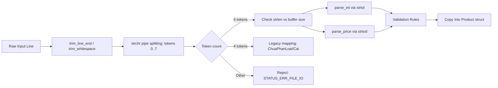

# Phân tích Bề mặt Tấn công và Nguy cơ An toàn Bộ nhớ (Attack Surface Analysis)

Tài liệu này xác định toàn bộ các điểm tiếp nhận dữ liệu không tin cậy, các phép toán nhạy cảm về kích thước bộ nhớ và các hàm trọng yếu cần ưu tiên kiểm chứng (Memory Safety Audit & Verification) trong chương trình C quản lý kho (Baseline v0).

---

## 1. Các Vector Tiếp nhận Dữ liệu Đầu vào (Input Vectors)

### 1.1. Vector 1: Đầu vào Người dùng qua Bàn phím (Standard Input - `stdin`)
- **Tệp / Hàm tiếp nhận**:
  - `safe_read_line(const char *prompt, char *buffer, size_t size)` trong [utils.c](file:///c:/Du_an/ATPM/ATPM_Group_04_inventory-memory-audit/source/src/utils.c)
  - Vòng lặp menu chính và các hàm `handle_*` trong [main.c](file:///c:/Du_an/ATPM/ATPM_Group_04_inventory-memory-audit/source/src/main.c)
- **Đặc điểm kỹ thuật**:
  - Sử dụng `fgets(buffer, (int)size, stdin)` với kích thước bộ đệm xác định.
  - Xử lý xóa ký tự xuống dòng `\n` và `\r`.
  - Cơ chế dọn sạch bộ đệm `while ((c = getchar()) != '\n' && c != EOF)` khi người dùng nhập dữ liệu vượt quá kích thước `size`.
- **Rủi ro tiềm ẩn**:
  - Nhập chuỗi rỗng hoặc chỉ chứa khoảng trắng gây lỗi logic.
  - Chuỗi chứa ký tự phân cách cấm (`|`, `,`, `;`) làm sai lệch cấu trúc bản ghi khi ghi ra tệp.
  - Nhập số âm hoặc chuỗi ký tự bất thường cho trường số lượng và đơn giá.

### 1.2. Vector 2: Đầu vào Dữ liệu từ Tệp tin (File Input)
- **Tệp / Hàm tiếp nhận**:
  - `load_products_from_file(Inventory *inventory, const char *path)` trong [file_io.c](file:///c:/Du_an/ATPM/ATPM_Group_04_inventory-memory-audit/source/src/file_io.c)
  - `display_and_validate_file(const char *filepath)` trong [main.c](file:///c:/Du_an/ATPM/ATPM_Group_04_inventory-memory-audit/source/src/main.c)
  - Tệp dữ liệu mục tiêu: `products.txt`, `transactions.txt`.
- **Đặc điểm kỹ thuật**:
  - Khai báo bộ đệm dòng cố định `char line[LINE_BUFFER_SIZE]` (`LINE_BUFFER_SIZE = 512`).
  - Đọc từng dòng bằng `fgets`.
  - Kiểm tra dòng bị cắt ngắn: `if (strchr(line, '\n') == NULL && !feof(file))`.
- **Rủi ro tiềm ẩn**:
  - Dòng dữ liệu dài bất thường vượt quá 512 bytes (Buffer Truncation / Injection).
  - Tệp chứa ký tự null byte `\0` hoặc ký tự điều khiển ngầm.
  - Số lượng trường không chuẩn (ít hơn hoặc nhiều hơn 6 trường).
  - Giá trị trường số lượng hoặc giá bị tràn số (`LONG_MAX`, `INFINITY`, `NaN`).

---

## 2. Đường Xử lý Parser và Xử lý Chuỗi (Parsing Pipeline)

Đường ống xử lý dữ liệu từ chuỗi thô sang đối tượng bộ nhớ gồm các bước nối tiếp:

### 2.1. Phân tách Token (`parse_product_line` / `split_line`)
- `parse_product_line()` sử dụng con trỏ `cursor` và `strchr(cursor, '|')` để tách tối đa 8 tokens.
- **Rủi ro**: Nếu chuỗi không chứa ký tự null kết thúc hợp lệ, `strchr()` có thể đọc vượt ra ngoài biên của bộ đệm (Out-of-Bounds Read - CWE-125).

### 2.2. Chuyển đổi Số nguyên và Số thực (`parse_int`, `parse_price`, `safe_str_to_int`, `safe_str_to_double`)
- Sử dụng hàm chuẩn `strtol()` và `strtod()` kết hợp kiểm tra `errno == ERANGE` và con trỏ kết thúc `*end == '\0'`.
- Chặn số âm (`parsed < 0`), chặn tràn `INT_MAX`, chặn các giá trị đặc biệt của số thực (`!isfinite(parsed)` chặn `NaN` và `Inf`).

---

## 3. Các Phép Tính Kích thước Bộ nhớ và Cấp phát Động

| Phép toán kích thước | Vị trí trong mã nguồn | Phân tích nguy cơ an toàn bộ nhớ |
|----------------------|-----------------------|----------------------------------|
| `malloc(INITIAL_CAPACITY * sizeof(Product))` | [product.c:14](file:///c:/Du_an/ATPM/ATPM_Group_04_inventory-memory-audit/source/src/product.c#L14) | Cấp phát 16 * 184 bytes = 2944 bytes. An toàn vì kích thước hằng số nhỏ. Tuy nhiên phải luôn kiểm tra con trỏ trả về khác `NULL` (CWE-476). |
| `realloc(list->items, new_cap * sizeof(Product))` | [product.c:119](file:///c:/Du_an/ATPM/ATPM_Group_04_inventory-memory-audit/source/src/product.c#L119) | **Điểm rủi ro cao**: Phép nhân `new_cap * sizeof(Product)` có thể bị tràn số nguyên (Integer Multiplication Overflow - CWE-190) nếu `new_cap` vượt quá `SIZE_MAX / sizeof(Product)` trên hệ thống 32-bit hoặc khi dữ liệu cực lớn. |
| `memmove(&list->items[i], &list->items[i+1], (list->count - i - 1) * sizeof(Product))` | [product.c:212](file:///c:/Du_an/ATPM/ATPM_Group_04_inventory-memory-audit/source/src/product.c#L212) | Phép tính kích thước vùng nhớ cần dồn. Nếu `i >= list->count`, biểu thức `list->count - i - 1` sẽ bị underflow thành số nguyên không dấu khổng lồ, gây tràn bộ đệm đọc/ghi (Heap Buffer Overflow - CWE-122). |
| `product->quantity += quantity` | [inventory.c:45](file:///c:/Du_an/ATPM/ATPM_Group_04_inventory-memory-audit/source/src/inventory.c#L45) | **Điểm rủi ro cao**: Nhập kho có thể dẫn tới tràn số nguyên có dấu `INT_MAX` nếu không kiểm tra bằng `check_addition_overflow()` trước khi thực hiện cộng. |

---

## 4. Bảng Ánh xạ Bề mặt Tấn công tới Hàm C Thực tế

| Điểm tiếp xúc (Attack Point) | Tệp tin & Hàm C cụ thể | Phân loại CWE | Vector tấn công / Kịch bản lỗi | Mức độ rủi ro |
|------------------------------|------------------------|---------------|--------------------------------|---------------|
| **File Parser Buffer** | [file_io.c:107](file:///c:/Du_an/ATPM/ATPM_Group_04_inventory-memory-audit/source/src/file_io.c#L107) `load_products_from_file` | CWE-120 / CWE-125 | Tệp `products.txt` chứa một dòng dài bất thường không có ký tự kết thúc dòng `\n`. | Cao |
| **Token Parsing Logic** | [file_io.c:46](file:///c:/Du_an/ATPM/ATPM_Group_04_inventory-memory-audit/source/src/file_io.c#L46) `parse_product_line` | CWE-125 | Tách chuỗi dùng `strchr` và ghi đè `\0` trực tiếp lên chuỗi đầu vào. | Trung bình |
| **Heap Dynamic Reallocation** | [product.c:117](file:///c:/Du_an/ATPM/ATPM_Group_04_inventory-memory-audit/source/src/product.c#L117) `add_product` | CWE-416 / CWE-190 | Di dời bộ nhớ làm vô hiệu hóa các con trỏ mượn được trả về trước đó bởi `find_product()`. Phép nhân `new_cap * sizeof(Product)` có nguy cơ tràn số. | **Rất cao** |
| **Heap Double Free Defense** | [product.c:27](file:///c:/Du_an/ATPM/ATPM_Group_04_inventory-memory-audit/source/src/product.c#L27) `product_list_free` | CWE-415 | Gọi hàm giải phóng hai lần liên tiếp nếu con trỏ không được đặt lại về `NULL`. | Cao |
| **Array Shift via Memmove** | [product.c:212](file:///c:/Du_an/ATPM/ATPM_Group_04_inventory-memory-audit/source/src/product.c#L212) `delete_product` | CWE-122 | Lỗi lệch chỉ số khi tính toán kích thước byte cần dịch chuyển trong mảng `items`. | Trung bình |
| **Integer Addition Overflow** | [inventory.c:41](file:///c:/Du_an/ATPM/ATPM_Group_04_inventory-memory-audit/source/src/inventory.c#L41) `import_stock` | CWE-190 | Nhập số lượng lớn vượt quá khoảng biểu diễn `INT_MAX`, dẫn đến số lượng tồn kho biến thành số âm. | Cao |
| **Stock Underflow Defense** | [inventory.c:60](file:///c:/Du_an/ATPM/ATPM_Group_04_inventory-memory-audit/source/src/inventory.c#L60) `export_stock` | CWE-839 | Xuất kho với số lượng lớn hơn tồn kho thực tế nếu thiếu hàm `validate_export_quantity`. | Trung bình |
| **String Copy Buffers** | [utils.c:44](file:///c:/Du_an/ATPM/ATPM_Group_04_inventory-memory-audit/source/src/utils.c#L44) `safe_string_copy` | CWE-120 | Sao chép chuỗi từ chuỗi nguồn dài hơn kích thước bộ đệm đích. | Thấp (Đã phòng thủ) |
| **In-place String Trimming** | [utils.c:21](file:///c:/Du_an/ATPM/ATPM_Group_04_inventory-memory-audit/source/src/utils.c#L21) `trim_whitespace` | CWE-125 | Chuỗi không có null-terminator hoặc con trỏ trỏ tới vùng nhớ hằng chuỗi chỉ đọc (Read-only string literal) gây Segmentation Fault. | Cao |
| **Summary Category Overflow** | [report.c:46](file:///c:/Du_an/ATPM/ATPM_Group_04_inventory-memory-audit/source/src/report.c#L46) `calculate_category_summaries` | CWE-122 | Mảng kết quả `CategorySummary summaries[32]` bị tràn nếu kho hàng chứa nhiều hơn 32 phân loại ngành hàng khác nhau. | Trung bình |

---

## 5. Danh mục Hàm C Cần Ưu tiên Kiểm chứng (Verification Priority)

Nhóm các hàm được xếp loại ưu tiên cao nhất cho các công cụ kiểm chứng hình thức (CBMC, Z3), công cụ phân tích tĩnh (Cppcheck), sanitizers (ASan, UBSan) và Fuzzing:

1. **`add_product()`** ([product.c](file:///c:/Du_an/ATPM/ATPM_Group_04_inventory-memory-audit/source/src/product.c)): Kiểm chứng bất biến mở rộng heap, bảo toàn dữ liệu cũ, không rò rỉ bộ nhớ khi `realloc` thất bại.
2. **`product_list_free()`** ([product.c](file:///c:/Du_an/ATPM/ATPM_Group_04_inventory-memory-audit/source/src/product.c)): Kiểm chứng trạng thái con trỏ sau khi free, chống double-free.
3. **`parse_product_line()`** ([file_io.c](file:///c:/Du_an/ATPM/ATPM_Group_04_inventory-memory-audit/source/src/file_io.c)): Kiểm chứng khả năng chống chịu trước các input file độc hại, ký tự lạ, độ dài biên.
4. **`import_stock()` & `export_stock()`** ([inventory.c](file:///c:/Du_an/ATPM/ATPM_Group_04_inventory-memory-audit/source/src/inventory.c)): Kiểm chứng bất biến tồn kho không âm và không tràn số nguyên.
5. **`trim_whitespace()`** ([utils.c](file:///c:/Du_an/ATPM/ATPM_Group_04_inventory-memory-audit/source/src/utils.c)): Kiểm chứng an toàn con trỏ và vùng nhớ có thể ghi.
