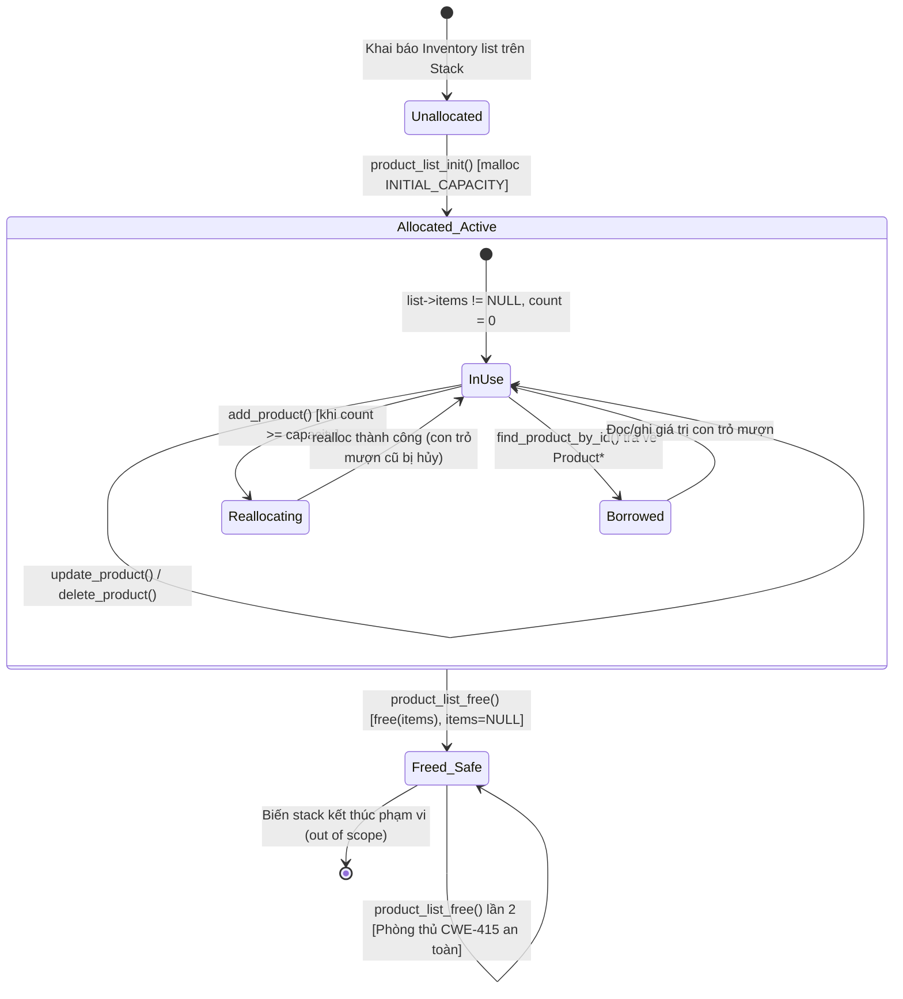

# Đặc tả Quản lý và Sở hữu Bộ nhớ (Memory Ownership Specification)

Tài liệu này xác định mô hình quản lý bộ nhớ, quyền sở hữu (ownership), vòng đời con trỏ và các trạng thái lỗi tiềm ẩn phục vụ quá trình kiểm chứng an toàn bộ nhớ (C Memory Safety Verification) cho chương trình C quản lý kho (Baseline v0).

---

## 1. Phân biệt Phân vùng Bộ nhớ: Stack và Heap

Hệ thống quản lý dữ liệu thông qua hai phân vùng bộ nhớ chính trong C:

| Đặc tính | Stack Memory | Heap Memory |
|----------|--------------|-------------|
| **Đối tượng lưu trữ** | - Biến cục bộ trong hàm (`Product p`, `char buf[256]`, `int status`).<br>- Con trỏ tham chiếu (`ProductList *list`, `Product *target`).<br>- Cấu trúc thống kê tổng hợp (`InventorySummary summary`). | - Mảng động các sản phẩm `Product *items`.<br>- Vùng nhớ được cấp phát qua `malloc()` và co giãn qua `realloc()`. |
| **Quản lý vòng đời** | Tự động phân bổ khi vào stack frame của hàm và tự động giải phóng khi hàm kết thúc (out of scope). | Do người lập trình chủ động quản lý thông qua các hàm `product_list_init()`, `add_product()`, và `product_list_free()`. |
| **Nguy cơ an toàn bộ nhớ** | - Tràn bộ đệm stack (Stack Buffer Overflow).<br>- Trả về con trỏ tới biến cục bộ trên stack (Dangling Pointer to Stack Frame). | - Rò rỉ bộ nhớ (Memory Leak - CWE-401).<br>- Giải phóng hai lần (Double Free - CWE-415).<br>- Sử dụng sau khi giải phóng / di dời (Use-After-Free - CWE-416).<br>- Giải phóng con trỏ không hợp lệ (Invalid Free - CWE-761). |

---

## 2. Mô hình Dữ liệu và Quyền Sở hữu (Ownership Model)

### 2.1. Cấu trúc `Product` (Value Semantics - Flat Struct)
- `Product` là cấu trúc tự chứa (flat layout), không chứa bất kỳ con trỏ nội bộ nào.
- Toàn bộ các trường dữ liệu chuỗi (`id`, `name`, `category`, `unit`) là các mảng ký tự cố định nằm liên tục trong bộ nhớ của struct.
- **Quyền sở hữu**: Khi truyền một biến `Product` theo giá trị hoặc sao chép qua `memcpy`/gán bằng `=`, toàn bộ dữ liệu được copy độc lập. Không phát sinh chia sẻ tài nguyên động nội bộ.

### 2.2. Cấu trúc `ProductList` / `Inventory` (Container Ownership)
- `ProductList` là chủ sở hữu duy nhất (**Exclusive Owner**) của khối bộ nhớ heap mà con trỏ `items` trỏ tới.
- Không một cấu trúc hoặc module nào khác được phép nắm giữ quyền sở hữu hoặc gọi `free()` trực tiếp lên con trỏ `items`.

```text
[Stack Frame: main / inventory]
  +--------------------------------+
  | Inventory list                 |
  |   .count    = 2                |
  |   .capacity = 16               |
  |   .items    = 0x60000100 ------+-----> [Heap Memory: Continuous Buffer]
  +--------------------------------+       +------------------------------------+
                                           | items[0]: Product (SP001, Dell...) |
                                           +------------------------------------+
                                           | items[1]: Product (SP002, Mouse...)|
                                           +------------------------------------+
                                           | ... (uninitialized capacity slots) |
                                           +------------------------------------+
```

---

## 3. Các Hàm Quản lý Vòng đời Bộ nhớ

### 3.1. Khởi tạo (`product_list_init` / `inventory_init`)
```c
int product_list_init(ProductList *list) {
    if (list == NULL) return STATUS_ERR_NULL_PTR;

    list->items = (Product *)malloc(INITIAL_CAPACITY * sizeof(Product));
    if (list->items == NULL) {
        list->count = 0;
        list->capacity = 0;
        return STATUS_ERR_MEMORY;
    }
    list->count = 0;
    list->capacity = INITIAL_CAPACITY;
    return STATUS_SUCCESS;
}
```
- **Hành vi**: Cấp phát khối bộ nhớ khởi điểm cho 16 phần tử `Product` trên heap.
- **Trạng thái an toàn**: Kiểm tra `list == NULL` và `list->items == NULL`. Nếu `malloc` thất bại, thiết lập trạng thái an toàn (`count = 0, capacity = 0`) và trả về `STATUS_ERR_MEMORY`.

### 3.2. Cấp phát lại và Mở rộng (`add_product`)
```c
if (list->count >= list->capacity) {
    size_t new_cap = (list->capacity == 0) ? INITIAL_CAPACITY : (list->capacity * 2);
    Product *new_items = (Product *)realloc(list->items, new_cap * sizeof(Product));
    if (new_items == NULL) {
        return STATUS_ERR_MEMORY; /* Giữ nguyên list->items cũ, tránh rò rỉ bộ nhớ */
    }
    list->items = new_items;
    list->capacity = new_cap;
}
```
- **Hành vi**: Khi `count` chạm trần `capacity`, hệ thống thực hiện nhân đôi sức chứa.
- **Trạng thái an toàn**: Sử dụng con trỏ tạm thời `new_items` để hứng kết quả của `realloc()`. Nếu `realloc()` thất bại (trả về `NULL`), con trỏ cũ `list->items` vẫn được bảo toàn nguyên vẹn, ngăn chặn lỗi rò rỉ bộ nhớ (CWE-401).

### 3.3. Xóa phần tử (`delete_product`)
```c
int delete_product(ProductList *list, const char *id) {
    /* ... tìm kiếm phần tử ... */
    if (i < list->count - 1) {
        memmove(&list->items[i], &list->items[i + 1], (list->count - i - 1) * sizeof(Product));
    }
    list->count--;
    return STATUS_SUCCESS;
}
```
- **Hành vi**: Dồn mảng bằng `memmove` để xử lý an toàn các vùng nhớ chồng lấn (overlapping memory).
- **Quyết định thiết kế**: Thao tác xóa **không co rút** mảng (không gọi `realloc` giảm dung lượng) nhằm bảo đảm tính ổn định và tránh chi phí cấp phát lại liên tục. `capacity` được giữ nguyên cho các lần chèn tiếp theo.

### 3.4. Thu hồi tài nguyên (`product_list_free` / `inventory_free`)
```c
void product_list_free(ProductList *list) {
    if (list != NULL && list->items != NULL) {
        free(list->items);
        list->items = NULL;
        list->count = 0;
        list->capacity = 0;
    }
}
```
- **Hành vi**: Giải phóng vùng nhớ heap duy nhất `items`.
- **Trạng thái an toàn**: Gán ngay lập tức `list->items = NULL` cùng với `count = 0` và `capacity = 0`. Điều này tạo cơ chế phòng ngự (Defensive Programming) chống lỗi Double Free (CWE-415) nếu hàm vô tình bị gọi lại lần thứ hai.

---

## 4. Cơ chế Mượn Con trỏ (Borrowed Pointers) và Nguy cơ Invalidation

### 4.1. Bản chất con trỏ mượn
Các hàm truy vấn dữ liệu như:
- `find_product_by_id(const ProductList *list, const char *id)`
- `find_product(const Inventory *inventory, const char *product_id)`
- `find_product_mutable(Inventory *inventory, const char *product_id)`

Trả về con trỏ trực tiếp trỏ vào một phần tử `&list->items[i]` bên trong mảng heap.

> [!CAUTION]
> **Quy tắc bắt buộc đối với con trỏ mượn (Borrowed Pointer Invariant):**
> 1. Con trỏ mượn **không sở hữu bộ nhớ**: Tuyệt đối không được gọi `free()` trên con trỏ mượn (vi phạm gây lỗi Heap Corruption / Invalid Free - CWE-761).
> 2. Vòng đời của con trỏ mượn bị phụ thuộc chặt chẽ vào cấu trúc `ProductList`.

### 4.2. Tác động của `realloc` đối với con trỏ cũ (Dangling Pointer / Use-After-Free)
Khi hàm `add_product()` được gọi và mảng bị đầy (`count >= capacity`), `realloc()` có thể chuyển toàn bộ khối nhớ sang một địa chỉ heap mới:
1. Địa chỉ cũ bị hệ thống thu hồi.
2. Toàn bộ các con trỏ mượn được lưu trữ trước thời điểm gọi `add_product()` sẽ trở thành **con trỏ lơ lửng (dangling pointers)**.
3. Nếu ứng dụng tiếp tục đọc hoặc ghi qua các con trỏ cũ này, lỗi nghiêm trọng **Use-After-Free (CWE-416)** sẽ xảy ra.

```text
[Trước realloc]
  items -> [ 0x1000: SP001 ] [ 0x10B8: SP002 ]
  ptr   -> [ 0x1000 ] (Borrowed pointer tới SP001)

[Thực hiện add_product -> realloc di dời sang 0x5000]
  items -> [ 0x5000: SP001 ] [ 0x50B8: SP002 ] [ 0x5170: SP003 ]
  Vùng nhớ 0x1000 bị HỆ ĐIỀU HÀNH THU HỒI!

[Hậu quả]
  ptr vẫn trỏ tới [ 0x1000 ] -> DANGLING POINTER!
  Truy xuất *ptr => UNDEFINED BEHAVIOR / USE-AFTER-FREE (CWE-416)
```

---

## 5. Sơ đồ Vòng đời Bộ nhớ (Mermaid Diagram)



---

## 6. Các Trạng thái Lỗi Bộ nhớ Cần Kiểm chứng (Audit Targets)

| Mã lỗi | Tên lỗi chuẩn quốc tế | Vị trí có nguy cơ trong mã nguồn | Biểu hiện / Hậu quả |
|--------|-----------------------|----------------------------------|---------------------|
| **CWE-415** | Double Free | `product_list_free()`, `inventory_free()` | Giải phóng vùng đệm `items` hai lần nếu con trỏ không được đặt về `NULL`. |
| **CWE-476** | NULL Pointer Dereference | Mọi hàm nhận tham số con trỏ (`list`, `inventory`, `product`, `keyword`) nếu thiếu kiểm tra phòng ngự `if (ptr == NULL)`. | Crash chương trình do phân đoạn bộ nhớ (Segmentation Fault / Access Violation). |
| **CWE-416** | Use-After-Free | Giữ lại con trỏ trả về từ `find_product()` rồi gọi `add_product()` làm kích hoạt `realloc()`. | Đọc/ghi vào vùng nhớ heap đã giải phóng, gây sai lệch dữ liệu hoặc thực thi mã độc. |
| **CWE-190 / CWE-680** | Integer Overflow to Buffer Overflow | Phép tính `new_cap * sizeof(Product)` trong `product.c` và `check_addition_overflow` trong `inventory.c`. | Tràn số nguyên kích thước dẫn tới cấp phát vùng nhớ quá nhỏ so với nhu cầu, gây tràn bộ đệm heap. |
| **CWE-120** | Classic Buffer Overflow | Thao tác sao chép chuỗi `safe_strcpy`, `snprintf`, đọc dòng `fgets` và `safe_read_line`. | Ghi đè bộ đệm chuỗi nếu độ dài đầu vào không được giới hạn nghiêm ngặt. |

> [!WARNING]
> Không được mặc định mọi con trỏ đều an toàn chỉ vì đã gọi `free()`. Một con trỏ sau khi giải phóng mà không được gán `NULL` vẫn chứa địa chỉ cũ và có thể bị lạm dụng dẫn tới lỗi bảo mật nghiêm trọng.
