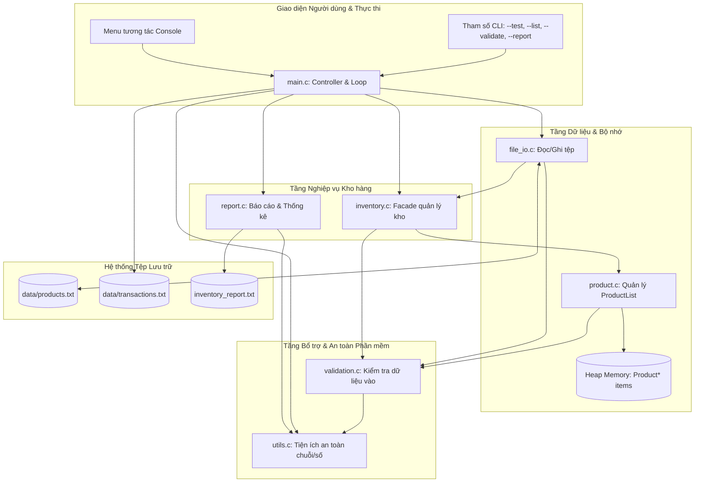
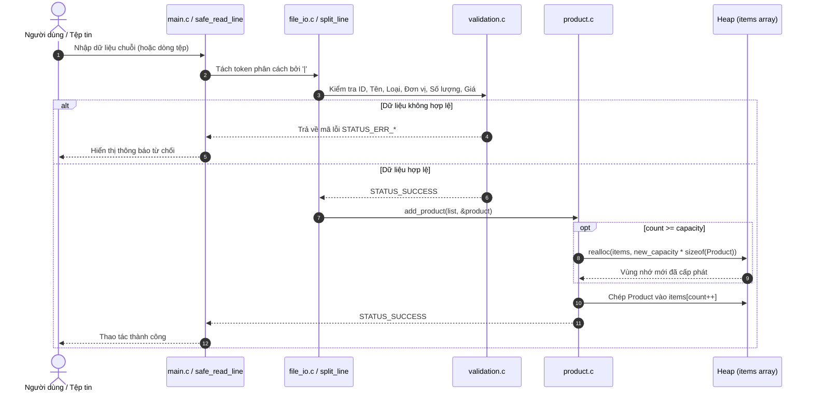

# Kiến trúc hệ thống chương trình C quản lý kho (Baseline v0)

## 1. Mục đích chương trình C
Chương trình C quản lý kho hàng được xây dựng theo chuẩn C17 nhằm mô phỏng các nghiệp vụ cốt lõi trong một hệ thống kho thực tế (nhập kho, xuất kho, cập nhật thông tin sản phẩm, tìm kiếm, lưu trữ tệp tin và báo cáo thống kê).

> [!IMPORTANT]
> Đây không phải dự án phần mềm thương mại. Chương trình được thiết kế với cấu trúc module hóa, trực quan, phục vụ làm **đối tượng nghiên cứu và kiểm chứng an toàn bộ nhớ (C Memory Safety Verification)** trong khuôn khổ môn học An toàn phần mềm.

---

## 2. Danh sách module và trách nhiệm

Hệ thống được tổ chức thành các module độc lập với ranh giới trách nhiệm rõ ràng:

| Module | Tệp tin Header & Nguồn | Trách nhiệm chính |
|--------|------------------------|-------------------|
| **Models** | [models.h](file:///c:/Du_an/ATPM/ATPM_Group_04_inventory-memory-audit/source/include/models.h) | Định nghĩa các cấu trúc dữ liệu nền tảng (`Product`, `ProductList`, `Inventory`), hằng số kích thước chuỗi, dung lượng ban đầu và bảng mã trạng thái/mã lỗi `STATUS_*`. |
| **Inventory** | [inventory.h](file:///c:/Du_an/ATPM/ATPM_Group_04_inventory-memory-audit/source/include/inventory.h)<br>[inventory.c](file:///c:/Du_an/ATPM/ATPM_Group_04_inventory-memory-audit/source/src/inventory.c) | Đóng vai trò lớp nghiệp vụ (Business Facade) của kho hàng: khởi tạo, giải phóng, nhập kho (`import_stock`), xuất kho (`export_stock`), cập nhật tồn kho (`update_stock`), tìm kiếm sản phẩm. |
| **Product** | [product.h](file:///c:/Du_an/ATPM/ATPM_Group_04_inventory-memory-audit/source/include/product.h)<br>[product.c](file:///c:/Du_an/ATPM/ATPM_Group_04_inventory-memory-audit/source/src/product.c) | Quản lý danh sách sản phẩm động trên heap: khởi tạo (`product_list_init`), giải phóng (`product_list_free`), thêm mới (`add_product`), cập nhật (`update_product`), xóa (`delete_product`), tìm kiếm theo ID và theo tên. Quản lý việc cấp phát lại bộ nhớ (`realloc`). |
| **File I/O** | [file_io.h](file:///c:/Du_an/ATPM/ATPM_Group_04_inventory-memory-audit/source/include/file_io.h)<br>[file_io.c](file:///c:/Du_an/ATPM/ATPM_Group_04_inventory-memory-audit/source/src/file_io.c) | Tương tác với hệ thống tệp: nạp sản phẩm từ tệp (`load_products_from_file`), ghi sản phẩm ra tệp (`save_products_to_file`). Xử lý phân tích cú pháp dòng dữ liệu 6 trường và chế độ tương thích ngược 4 trường cũ. |
| **Validation** | [validation.h](file:///c:/Du_an/ATPM/ATPM_Group_04_inventory-memory-audit/source/include/validation.h)<br>[validation.c](file:///c:/Du_an/ATPM/ATPM_Group_04_inventory-memory-audit/source/src/validation.c) | Xác thực tính hợp lệ của dữ liệu đầu vào: định dạng và độ dài mã ID, tên, loại, đơn vị, giá trị số lượng, giá cả, phát hiện nguy cơ tràn số nguyên (`check_addition_overflow`), kiểm tra đủ tồn kho (`validate_export_quantity`). |
| **Utils** | [utils.h](file:///c:/Du_an/ATPM/ATPM_Group_04_inventory-memory-audit/source/include/utils.h)<br>[utils.c](file:///c:/Du_an/ATPM/ATPM_Group_04_inventory-memory-audit/source/src/utils.c) | Thư viện tiện ích dùng chung: cắt tỉa khoảng trắng (`trim_whitespace`), sao chép chuỗi an toàn (`safe_string_copy`), đọc dòng an toàn từ stdin (`safe_read_line`), tách token (`split_line`), chuyển đổi số an toàn (`safe_str_to_int`, `safe_str_to_double`), định tuyến đường dẫn tệp (`find_file_path`). |
| **Report** | [report.h](file:///c:/Du_an/ATPM/ATPM_Group_04_inventory-memory-audit/source/include/report.h)<br>[report.c](file:///c:/Du_an/ATPM/ATPM_Group_04_inventory-memory-audit/source/src/report.c) | Thống kê số liệu kho hàng: tổng quan tồn kho, phân nhóm danh mục ngành hàng, sản phẩm sắp hết hàng / đã hết hàng, xuất báo cáo ra tệp văn bản. |
| **Main** | [main.c](file:///c:/Du_an/ATPM/ATPM_Group_04_inventory-memory-audit/source/src/main.c) | Điểm khởi chạy chương trình (Entry Point), tiếp nhận tham số dòng lệnh CLI (`--list`, `--test`, `--validate`, `--report`, `--history`), quản lý vòng lặp menu giao diện dòng lệnh và nhật ký giao dịch. |

---

## 3. Kiến trúc dữ liệu chuẩn hóa

Toàn bộ hệ thống thống nhất sử dụng cấu trúc container duy nhất được định nghĩa tại [models.h](file:///c:/Du_an/ATPM/ATPM_Group_04_inventory-memory-audit/source/include/models.h):

```c
/* Cấu trúc sản phẩm cố định (Flat Struct, Value Semantics) */
typedef struct {
    char id[MAX_ID_LEN];            /* Mã sản phẩm (tối đa 19 ký tự + '\0') */
    char name[MAX_NAME_LEN];        /* Tên sản phẩm (tối đa 99 ký tự + '\0') */
    char category[MAX_CATEGORY_LEN];/* Phân loại hàng (tối đa 49 ký tự + '\0') */
    char unit[MAX_UNIT_LEN];        /* Đơn vị tính (tối đa 19 ký tự + '\0') */
    int quantity;                   /* Số lượng tồn kho (>= 0) */
    double price;                   /* Đơn giá niêm yết (>= 0.0) */
} Product;

/* Cấu trúc danh sách mảng động quản lý bộ nhớ duy nhất */
typedef struct {
    Product *items;                 /* Vùng đệm heap chứa mảng Product */
    size_t count;                   /* Số lượng phần tử hiện đang lưu trữ */
    size_t capacity;                /* Sức chứa tối đa hiện tại trước khi realloc */
} ProductList;

/* Inventory là bí danh thống nhất cho ProductList */
typedef ProductList Inventory;
```

> [!NOTE]
> Mọi module trong hệ thống (`inventory.c`, `product.c`, `file_io.c`, `report.c`, `main.c`, `test_inventory.c`) đều truy xuất vùng đệm thông qua con trỏ `items`. Khái niệm `Inventory` và `ProductList` là đồng nhất về kiểu dữ liệu và bố cục bộ nhớ.

---

## 4. Các API cốt lõi của hệ thống

### 4.1. Nhóm khởi tạo và quản lý bộ nhớ
- `int product_list_init(ProductList *list)`: Cấp phát mảng ban đầu với `INITIAL_CAPACITY = 16`.
- `void product_list_free(ProductList *list)`: Thu hồi mảng heap và gán con trỏ về `NULL`.
- `int inventory_init(Inventory *inventory)`: Wrapper gọi `product_list_init`.
- `void inventory_free(Inventory *inventory)`: Wrapper gọi `product_list_free`.

### 4.2. Nhóm thao tác sản phẩm (CRUD)
- `int add_product(ProductList *list, const Product *prod)`: Kiểm tra validation, trùng lặp mã ID, tự động mở rộng mảng khi đầy (`realloc`) và chép sản phẩm vào cuối mảng.
- `int update_product(ProductList *list, const char *id, ...)`: Sửa đổi các trường thông tin của sản phẩm có sẵn.
- `int delete_product(ProductList *list, const char *id)`: Tìm sản phẩm và dồn các phần tử phía sau lên bằng `memmove`, giảm `count`.
- `Product* find_product_by_id(const ProductList *list, const char *id)`: Tìm kiếm tuyến tính theo ID chính xác.
- `int search_products_by_name(const ProductList *list, const char *keyword, ...)`: Tìm kiếm gần đúng không phân biệt chữ hoa/thường.

### 4.3. Nhóm nghiệp vụ kho hàng
- `int import_stock(Inventory *inventory, const char *product_id, int quantity)`: Kiểm tra tràn số nguyên (`check_addition_overflow`) và cộng tồn kho.
- `int export_stock(Inventory *inventory, const char *product_id, int quantity)`: Kiểm tra tồn kho khả dụng (`validate_export_quantity`) và trừ tồn kho.
- `int update_stock(Inventory *inventory, const char *product_id, int new_quantity)`: Thiết lập lại tồn kho chính xác.

### 4.4. Nhóm lưu trữ tệp tin
- `int load_products_from_file(Inventory *inventory, const char *path)`: Đọc và phân tích cú pháp từng dòng tệp (hỗ trợ 6 trường hoặc 4 trường).
- `int save_products_to_file(const Inventory *inventory, const char *path)`: Ghi toàn bộ dữ liệu ra tệp theo định dạng 6 trường chuẩn có dòng tiêu đề.

---

## 5. Sơ đồ kiến trúc tổng thể (Mermaid Diagram)



---

## 6. Luồng dữ liệu: Từ Input tới Vùng nhớ (Data Flow)



---

## 7. Giới hạn của hệ thống (System Boundaries & Constraints)

1. **Giới hạn chuỗi**:
   - `MAX_ID_LEN = 20`: Chuỗi mã ID tối đa 19 ký tự hữu ích.
   - `MAX_NAME_LEN = 100`: Tên sản phẩm tối đa 99 ký tự hữu ích.
   - `MAX_CATEGORY_LEN = 50`: Tên phân loại tối đa 49 ký tự hữu ích.
   - `MAX_UNIT_LEN = 20`: Đơn vị tính tối đa 19 ký tự hữu ích.
2. **Kích thước dòng tệp**:
   - `LINE_BUFFER_SIZE = 512`: Độ dài tối đa của một dòng dữ liệu trong tệp `products.txt`. Các dòng vượt quá ngưỡng này sẽ bị phát hiện và từ chối để ngăn ngừa tràn bộ đệm.
3. **Dung lượng mảng động**:
   - Dung lượng ban đầu: `INITIAL_CAPACITY = 16`.
   - Mỗi lần đầy mảng sẽ nhân đôi dung lượng (`capacity * 2`).
   - Giới hạn lý thuyết phụ thuộc vào bộ nhớ khả dụng của hệ thống và giới hạn kiểu `size_t`.
