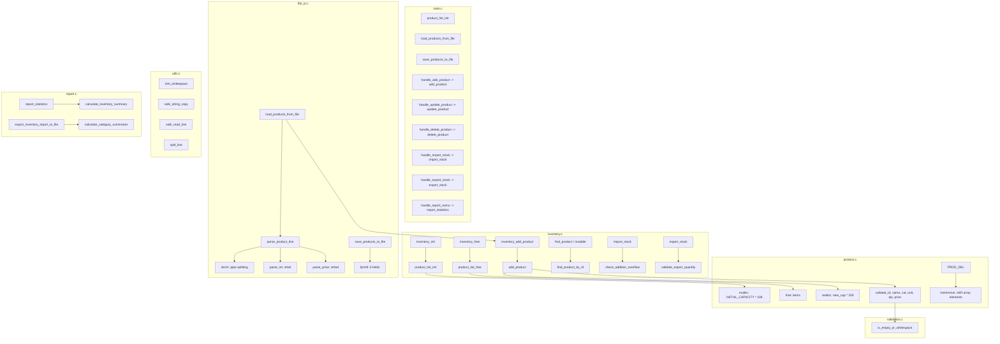

# Danh mục Mã nguồn và Thống kê Cấu trúc Hệ thống (Source Inventory)

## 1. Thông tin Phiên bản và Phạm vi Rà soát
- **Dự án**: Kiểm chứng an toàn bộ nhớ cho chương trình C mô phỏng quản lý kho
- **Nhánh Git**: `audit/step2-risk-specification`
- **Commit SHA Baseline**: `44202070c68002d9af068374478cdc83098dd4d8`
- **Tiêu chuẩn ngôn ngữ**: ISO C17 (`-std=c17`)
- **Phạm vi phân tích**: Toàn bộ 7 module C nguồn (`source/src/`), 7 tệp tiêu đề (`source/include/`) và 3 bộ kiểm thử (`source/tests/`, `tests/`).

---

## 2. Thống kê Quy mô Dòng lệnh (Lines of Code - LOC Metrics)

> [!NOTE]
> **Quy tắc tính LOC (Physical Code Counting Rule)**:
> - **Total Lines**: Tổng số dòng vật lý trong tệp tin.
> - **Code LOC**: Số dòng mã lệnh thực thi (không tính dòng trống và dòng chỉ chứa chú thích).
> - **Comment Lines**: Số dòng chú thích đơn dòng (`//`) hoặc khối chú thích đa dòng (`/* ... */`).
> - **Blank Lines**: Số dòng hoàn toàn trống hoặc chỉ chứa khoảng trắng/ký tự xuống dòng.

| Nhóm tệp tin | Đường dẫn tệp | Tổng dòng (Total) | Mã lệnh (Code LOC) | Chú thích (Comments) | Dòng trống (Blank) |
|---|---|:---:|:---:|:---:|:---:|
| Header | `source/include/file_io.h` | 10 | 6 | 1 | 3 |
| Header | `source/include/inventory.h` | 23 | 13 | 2 | 8 |
| Header | `source/include/models.h` | 49 | 37 | 4 | 8 |
| Header | `source/include/product.h` | 67 | 11 | 47 | 9 |
| Header | `source/include/report.h` | 107 | 38 | 54 | 15 |
| Header | `source/include/utils.h` | 42 | 15 | 15 | 12 |
| Header | `source/include/validation.h` | 31 | 19 | 5 | 7 |
| Source C | `source/src/file_io.c` | 165 | 148 | 0 | 17 |
| Source C | `source/src/inventory.c` | 83 | 71 | 0 | 12 |
| Source C | `source/src/main.c` | 802 | 683 | 23 | 96 |
| Source C | `source/src/product.c` | 250 | 189 | 25 | 36 |
| Source C | `source/src/report.c` | 335 | 285 | 1 | 49 |
| Source C | `source/src/utils.c` | 234 | 189 | 4 | 41 |
| Source C | `source/src/validation.c` | 312 | 244 | 5 | 63 |
| Test Suite | `source/tests/smoke_test.c` | 189 | 149 | 15 | 25 |
| Test Suite | `source/tests/test_inventory.c` | 48 | 42 | 0 | 6 |
| Test Suite | `tests/test_utils.c` | 120 | 90 | 7 | 23 |
| **TỔNG CỘNG** | **17 tệp tin** | **2867** | **2229** | **208** | **430** |

> [!TIP]
> - **7 Module C nghiệp vụ** (`source/src/`): Tổng cộng **2,181 dòng vật lý**, **1,809 Code LOC**.
> - **7 Tệp Headers** (`source/include/`): Tổng cộng **329 dòng vật lý**, **139 Code LOC**.
> - **3 Bộ Kiểm thử** (`tests/`): Tổng cộng **357 dòng vật lý**, **281 Code LOC**.
> - **Tổng số hàm được định nghĩa**: **70 hàm**.

---

## 3. Danh mục Chi tiết Toàn bộ các Hàm C (Function Catalog)

Mỗi hàm trong hệ thống được rà soát kỹ lưỡng về phạm vi truy cập (Public/Internal), tham số con trỏ, các thao tác bộ nhớ nhạy cảm và vị trí dòng mã:

| STT | Hàm C (Function) | Tệp nguồn | Dòng mã | Phạm vi (Scope) | Kiểu trả về | Tham số đầu vào (Parameters) | Thao tác bộ nhớ nhạy cảm |
|:---:|---|---|:---:|:---:|---|---|---|
| 1 | `trim_line_end()` | `source/src/file_io.c` | L12-L18 | **Public (API)** | `static void` | `char *line` | None (Pure logic/arithmetic) |
| 2 | `parse_int()` | `source/src/file_io.c` | L19-L31 | **Public (API)** | `static int` | `const char *text, int *value` | strtol(l) |
| 3 | `parse_price()` | `source/src/file_io.c` | L32-L44 | **Public (API)** | `static int` | `const char *text, double *value` | strtod |
| 4 | `parse_product_line()` | `source/src/file_io.c` | L45-L92 | **Public (API)** | `static int` | `char *line, Product *product` | memset, snprintf, strchr |
| 5 | `load_products_from_file()` | `source/src/file_io.c` | L93-L135 | **Public (API)** | `int` | `Inventory *inventory, const char *path` | fgets, strchr |
| 6 | `save_products_to_file()` | `source/src/file_io.c` | L136-L165 | **Public (API)** | `int` | `const Inventory *inventory, const char *path` | None (Pure logic/arithmetic) |
| 7 | `inventory_init()` | `source/src/inventory.c` | L9-L12 | **Public (API)** | `int` | `Inventory *inventory` | None (Pure logic/arithmetic) |
| 8 | `inventory_free()` | `source/src/inventory.c` | L13-L16 | **Public (API)** | `void` | `Inventory *inventory` | free |
| 9 | `inventory_add_product()` | `source/src/inventory.c` | L25-L28 | **Public (API)** | `int` | `Inventory *inventory, const Product *product` | None (Pure logic/arithmetic) |
| 10 | `import_stock()` | `source/src/inventory.c` | L29-L47 | **Public (API)** | `int` | `Inventory *inventory, const char *product_id, int quantity` | None (Pure logic/arithmetic) |
| 11 | `export_stock()` | `source/src/inventory.c` | L48-L66 | **Public (API)** | `int` | `Inventory *inventory, const char *product_id, int quantity` | None (Pure logic/arithmetic) |
| 12 | `update_stock()` | `source/src/inventory.c` | L67-L83 | **Public (API)** | `int` | `Inventory *inventory, const char *product_id, int new_quantity` | None (Pure logic/arithmetic) |
| 13 | `print_product_table()` | `source/src/main.c` | L24-L26 | Internal (static) | `void` | `const ProductList *list` | None (Pure logic/arithmetic) |
| 14 | `resolve_data_paths()` | `source/src/main.c` | L27-L34 | **Public (API)** | `static void` | `char *prod_path, char *trans_path, size_t max_len` | None (Pure logic/arithmetic) |
| 15 | `log_transaction()` | `source/src/main.c` | L35-L52 | **Public (API)** | `static void` | `const char *trans_file, const char *action, const char *id, int qty, int balance` | None (Pure logic/arithmetic) |
| 16 | `print_history()` | `source/src/main.c` | L53-L70 | **Public (API)** | `static void` | `const char *trans_file` | fgets |
| 17 | `get_status_desc()` | `source/src/main.c` | L75-L91 | **Public (API)** | `static const char*` | `int status` | None (Pure logic/arithmetic) |
| 18 | `print_product_list()` | `source/src/main.c` | L92-L129 | **Public (API)** | `void` | `const ProductList *list` | None (Pure logic/arithmetic) |
| 19 | `display_and_validate_file()` | `source/src/main.c` | L130-L201 | **Public (API)** | `static void` | `const char *filepath` | snprintf, fgets |
| 20 | `run_all_unit_tests()` | `source/src/main.c` | L206-L296 | **Public (API)** | `static void` | `` | free |
| 21 | `handle_add_product()` | `source/src/main.c` | L301-L368 | **Public (API)** | `static void` | `ProductList *list, const char *prod_file` | memset |
| 22 | `handle_update_product()` | `source/src/main.c` | L369-L434 | **Public (API)** | `static void` | `ProductList *list, const char *prod_file` | None (Pure logic/arithmetic) |
| 23 | `handle_delete_product()` | `source/src/main.c` | L435-L465 | **Public (API)** | `static void` | `ProductList *list, const char *prod_file` | None (Pure logic/arithmetic) |
| 24 | `handle_search_product()` | `source/src/main.c` | L466-L521 | **Public (API)** | `static void` | `const ProductList *list` | None (Pure logic/arithmetic) |
| 25 | `handle_import_stock()` | `source/src/main.c` | L522-L563 | **Public (API)** | `static void` | `ProductList *list, const char *prod_file, const char *trans_file` | None (Pure logic/arithmetic) |
| 26 | `handle_export_stock()` | `source/src/main.c` | L564-L605 | **Public (API)** | `static void` | `ProductList *list, const char *prod_file, const char *trans_file` | None (Pure logic/arithmetic) |
| 27 | `handle_report_menu()` | `source/src/main.c` | L606-L676 | **Public (API)** | `static void` | `const ProductList *list` | None (Pure logic/arithmetic) |
| 28 | `main()` | `source/src/main.c` | L681-L802 | **Public (API)** | `int` | `int argc, char *argv[]` | free |
| 29 | `product_list_init()` | `source/src/product.c` | L9-L24 | **Public (API)** | `int` | `ProductList *list` | malloc |
| 30 | `product_list_free()` | `source/src/product.c` | L27-L34 | **Public (API)** | `void` | `ProductList *list` | free |
| 31 | `safe_strcpy()` | `source/src/product.c` | L37-L44 | Internal (static) | `void` | `char *dest, const char *src, size_t dest_size` | snprintf |
| 32 | `contains_ignore_case()` | `source/src/product.c` | L47-L67 | Internal (static) | `int` | `const char *haystack, const char *needle` | None (Pure logic/arithmetic) |
| 33 | `add_product()` | `source/src/product.c` | L70-L138 | **Public (API)** | `int` | `ProductList *list, const Product *prod` | realloc |
| 34 | `update_product()` | `source/src/product.c` | L141-L200 | **Public (API)** | `int` | `ProductList *list, const char *id, const char *new_name, const char *new_category, const char *new_unit, int new_quantity, double new_price` | None (Pure logic/arithmetic) |
| 35 | `delete_product()` | `source/src/product.c` | L203-L220 | **Public (API)** | `int` | `ProductList *list, const char *id` | memmove |
| 36 | `find_product_by_id()` | `source/src/product.c` | L223-L233 | **Public (API)** | `Product*` | `const ProductList *list, const char *id` | None (Pure logic/arithmetic) |
| 37 | `search_products_by_name()` | `source/src/product.c` | L236-L250 | **Public (API)** | `int` | `const ProductList *list, const char *keyword, Product *results, size_t max_results, size_t *out_count` | None (Pure logic/arithmetic) |
| 38 | `calculate_inventory_summary()` | `source/src/report.c` | L8-L44 | **Public (API)** | `int` | `const ProductList *list, int low_stock_threshold, InventorySummary *summary` | memset |
| 39 | `calculate_category_summaries()` | `source/src/report.c` | L45-L87 | **Public (API)** | `int` | `const ProductList *list, CategorySummary *summaries, size_t max_summaries, size_t *out_count` | None (Pure logic/arithmetic) |
| 40 | `print_inventory_summary_report()` | `source/src/report.c` | L88-L121 | **Public (API)** | `void` | `const ProductList *list, int low_stock_threshold` | None (Pure logic/arithmetic) |
| 41 | `print_low_stock_report()` | `source/src/report.c` | L122-L150 | **Public (API)** | `void` | `const ProductList *list, int threshold` | None (Pure logic/arithmetic) |
| 42 | `print_out_of_stock_report()` | `source/src/report.c` | L151-L179 | **Public (API)** | `void` | `const ProductList *list` | None (Pure logic/arithmetic) |
| 43 | `print_category_summary_report()` | `source/src/report.c` | L180-L213 | **Public (API)** | `void` | `const ProductList *list` | None (Pure logic/arithmetic) |
| 44 | `export_inventory_report_to_file()` | `source/src/report.c` | L214-L270 | **Public (API)** | `int` | `const ProductList *list, const char *filepath, int low_stock_threshold` | None (Pure logic/arithmetic) |
| 45 | `is_empty_or_whitespace()` | `source/src/utils.c` | L7-L19 | **Public (API)** | `int` | `const char *str` | None (Pure logic/arithmetic) |
| 46 | `trim_whitespace()` | `source/src/utils.c` | L20-L42 | **Public (API)** | `char*` | `char *str` | memmove |
| 47 | `safe_string_copy()` | `source/src/utils.c` | L43-L66 | **Public (API)** | `int` | `char *dest, size_t dest_size, const char *src` | None (Pure logic/arithmetic) |
| 48 | `safe_read_line()` | `source/src/utils.c` | L67-L98 | **Public (API)** | `void` | `const char *prompt, char *buffer, size_t size` | fgets |
| 49 | `split_line()` | `source/src/utils.c` | L99-L120 | **Public (API)** | `int` | `char *line, char delimiter, char *tokens[], int max_tokens` | strchr |
| 50 | `safe_str_to_int()` | `source/src/utils.c` | L121-L157 | **Public (API)** | `int` | `const char *str, int *out_val` | strtol(l) |
| 51 | `safe_str_to_double()` | `source/src/utils.c` | L158-L188 | **Public (API)** | `int` | `const char *str, double *out_val` | strtod |
| 52 | `to_upper_case()` | `source/src/utils.c` | L189-L198 | **Public (API)** | `void` | `char *str` | None (Pure logic/arithmetic) |
| 53 | `to_lower_case()` | `source/src/utils.c` | L199-L208 | **Public (API)** | `void` | `char *str` | None (Pure logic/arithmetic) |
| 54 | `find_file_path()` | `source/src/utils.c` | L209-L234 | **Public (API)** | `const char*` | `const char *filename` | snprintf |
| 55 | `is_all_whitespace()` | `source/src/validation.c` | L6-L9 | **Public (API)** | `static int` | `const char *str` | None (Pure logic/arithmetic) |
| 56 | `validate_product_id()` | `source/src/validation.c` | L13-L31 | **Public (API)** | `int` | `const char *product_id` | None (Pure logic/arithmetic) |
| 57 | `validate_id()` | `source/src/validation.c` | L32-L35 | **Public (API)** | `int` | `const char *id` | None (Pure logic/arithmetic) |
| 58 | `validate_product_name()` | `source/src/validation.c` | L38-L60 | **Public (API)** | `int` | `const char *name` | None (Pure logic/arithmetic) |
| 59 | `validate_category()` | `source/src/validation.c` | L61-L84 | **Public (API)** | `int` | `const char *category` | None (Pure logic/arithmetic) |
| 60 | `validate_unit()` | `source/src/validation.c` | L85-L108 | **Public (API)** | `int` | `const char *unit` | None (Pure logic/arithmetic) |
| 61 | `validate_name_unit()` | `source/src/validation.c` | L109-L117 | **Public (API)** | `int` | `const char *name, const char *unit` | None (Pure logic/arithmetic) |
| 62 | `validate_product_info()` | `source/src/validation.c` | L118-L133 | **Public (API)** | `int` | `const char *name, const char *category, const char *unit` | None (Pure logic/arithmetic) |
| 63 | `validate_price()` | `source/src/validation.c` | L136-L141 | **Public (API)** | `int` | `double price` | None (Pure logic/arithmetic) |
| 64 | `validate_quantity()` | `source/src/validation.c` | L142-L148 | **Public (API)** | `int` | `int quantity` | None (Pure logic/arithmetic) |
| 65 | `validate_quantity_str()` | `source/src/validation.c` | L149-L197 | **Public (API)** | `int` | `const char *qty_str` | None (Pure logic/arithmetic) |
| 66 | `validate_price_str()` | `source/src/validation.c` | L198-L255 | **Public (API)** | `int` | `const char *price_str` | None (Pure logic/arithmetic) |
| 67 | `validate_price_quantity()` | `source/src/validation.c` | L256-L269 | **Public (API)** | `int` | `const char *price_str, const char *qty_str` | None (Pure logic/arithmetic) |
| 68 | `validate_price_quantity_values()` | `source/src/validation.c` | L270-L283 | **Public (API)** | `int` | `double price, int quantity` | None (Pure logic/arithmetic) |
| 69 | `validate_export_quantity()` | `source/src/validation.c` | L284-L295 | **Public (API)** | `int` | `int current_stock, int export_quantity` | None (Pure logic/arithmetic) |
| 70 | `check_addition_overflow()` | `source/src/validation.c` | L296-L311 | **Public (API)** | `int` | `int current_stock, int add_quantity` | None (Pure logic/arithmetic) |

---

## 4. Bảng Ma trận Gọi hàm giữa các Module (Inter-Module Call Graph)

