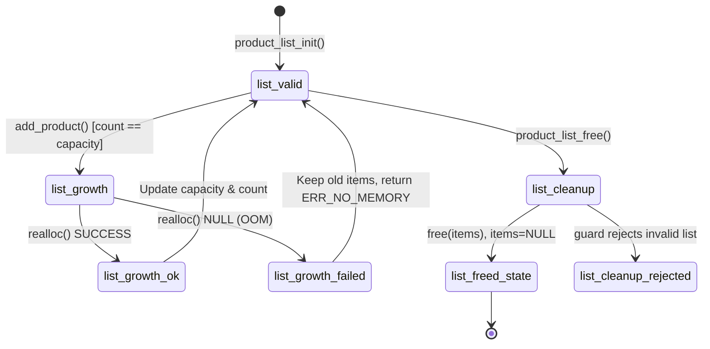
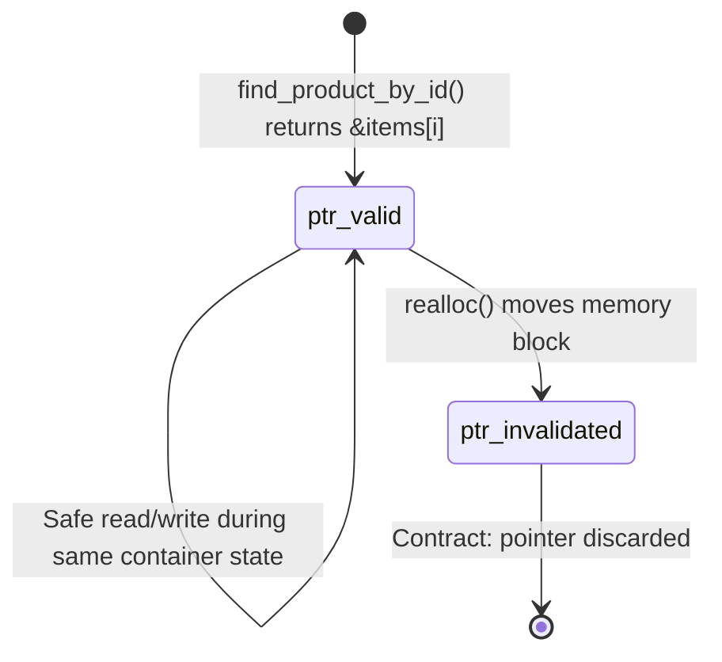

# KẾ HOẠCH HÌNH THỨC HÓA VÀ MÔ HÌNH HÓA THUỘC TÍNH AN TOÀN BỘ NHỚ (STEP 2)

**Dự án:** Kiểm chứng an toàn bộ nhớ cho chương trình C mô phỏng quản lý kho  
**Nhánh thực hiện:** `audit/step2-risk-specification`  
**Commit Baseline:** `44202070c68002d9af068374478cdc83098dd4d8`  
**Kỹ sư phụ trách:** Hà Văn Đô (Formal Verification & Memory Safety Specification)  
**Tài liệu nền tảng:** `Spec_Inventory_Memory_Safety_Audit_18REQ_CHUAN.xlsx`  

---

## 1. MỤC TIÊU VÀ ĐỊNH VỊ CỦA BƯỚC 2

Theo nhận xét chỉ đạo của Giảng viên:
> *"Xuất phát từ source code → compile time → error + warning → tổng hợp + đặc tả để hình thức hóa (tính phủ các trường hợp có thể xảy ra) → xây dựng code C mô phỏng lại rủi ro. Xây dựng đặc tả cho bài toán rủi ro an toàn."*

Bước 2 không phải là bước tuyên bố đã chứng minh hoàn toàn mọi định lý, cũng không phải tuyên bố đã chạy model checker trên toàn bộ không gian trạng thái. Mục tiêu cốt lõi của tài liệu này là:
1. **Thiết lập mô hình trạng thái rời rạc (Finite State Transition System)** cho các tiến trình cốt lõi: vòng đời danh sách cấp phát động, con trỏ mượn, bộ đệm dòng đọc file, xử lý nghiệp vụ nhập/xuất kho.
2. **Hình thức hóa 18 thuộc tính an toàn (Safety & Liveness Invariants)** bằng logic thời gian CTL (*Computation Tree Logic*) dựa trên đặc tả chuẩn 18 REQ.
3. **Phân tích bẫy logic "Đúng hiển nhiên" (Vacuous Truth)** xuất phát từ tập tiên đề loại trừ lẫn nhau (*Mutual Exclusion Axioms*).
4. **Mô hình hóa số học hình thức (SMT Bit-Vector Formulae)** bằng SMT-LIB v2 cho các biểu thức số học có nguy cơ tràn số (realloc growth, memory byte calculation, stock addition).
5. **Phân định ranh giới giữa Khả thỏa Số học (Arithmetic SAT) và Tính Khả đạt trong Mã nguồn (Code Reachability)**.

---

## 2. MÔ HÌNH TRẠNG THÁI RỜI RẠC (STATE TRANSITION MODELS)

Dựa trên cấu trúc kiến trúc `v0` và đặc tả chuẩn trong Sheet `MoHinhTrangThai`, hệ thống được mô hình hóa thành 5 hệ thống trạng thái con (subsystems):

### 2.1. Phân hệ Quản lý Vòng đời Danh sách Heap (`list_*`)
Mô hình hóa vòng đời của đối tượng `ProductList` và con trỏ mảng `items`:
- **Trạng thái:**
  - $S_0$ = `list_valid` (Khởi tạo ban đầu, `items != NULL`, `capacity > 0`, `count <= capacity`, `owner_valid`).
  - $S_1$ = `list_growth` (Bắt đầu gọi `realloc` mở rộng sức chứa khi `count == capacity`).
  - $S_2$ = `list_growth_ok` (Cấp phát lại thành công, `new_items != NULL`, `items` trỏ vùng nhớ mới, `capacity' = 2 * capacity`).
  - $S_3$ = `list_growth_failed` (`realloc` trả về `NULL`, `items` gốc vẫn được bảo toàn nhờ guard con trỏ tạm, `capacity` không đổi).
  - $S_4$ = `list_cleanup` (Tiến trình gọi `product_list_free`).
  - $S_5$ = `list_freed_state` (`free(items)` hoàn tất, gán `items = NULL`, `count = 0`, `capacity = 0`).
  - $S_6$ = `list_cleanup_rejected` (Con trỏ NULL hoặc danh sách không hợp lệ bị từ chối dọn dẹp an toàn).



### 2.2. Phân hệ Con trỏ Mượn và Vòng đời Truy cập (`ptr_*`)
Mô hình hóa hợp đồng mượn con trỏ nội bộ từ các hàm tra cứu (`find_product_by_id`, `find_product`):
- **Trạng thái:**
  - `ptr_valid` (`ptr_live`, `ptr_deref == true` - con trỏ trỏ vào vùng nhớ mảng đang hợp lệ).
  - `ptr_invalidated` (`ptr_invalid`, `ptr_deref == false` - con trỏ trỏ vào khối nhớ cũ đã bị `realloc` giải phóng).



### 2.3. Phân hệ Phân tích Cú pháp Tệp tin (`file_*`)
- **Trạng thái:**
  - `file_idle`: Chờ thao tác tệp tin.
  - `file_parsing`: Đang đọc từng dòng qua `fgets` và tách tokens.
  - `file_loaded`: Đọc thành công toàn bộ dòng hợp lệ vào bộ nhớ.
  - `file_rejected`: Từ chối tải khi phát hiện lỗi định dạng, lỗi tràn bộ đệm dòng, hoặc mở tệp thất bại.

### 2.4. Phân hệ Bộ đệm Chuỗi Ký tự (`buffer_*`)
- **Trạng thái:**
  - `buffer_idle`: Vùng đệm rỗng/sẵn sàng.
  - `buffer_processing`: Đang thực hiện sao chép/chuẩn hóa chuỗi (`safe_string_copy`, `trim_whitespace`).
  - `buffer_safe`: Sao chép thành công, ký tự `\0` được bảo đảm ở vị trí cuối.
  - `buffer_rejected`: Chuỗi nguồn vượt kích thước đích, hàm trả về mã lỗi trước khi ghi đè.

### 2.5. Phân hệ Nghiệp vụ Tồn kho (`product_op_*`)
- **Trạng thái:**
  - `product_op_idle`: Chờ lệnh từ người dùng/tệp tin.
  - `product_op_processing`: Đang kiểm tra điều kiện nghiệp vụ (mã định danh, số lượng, giá, số lượng xuất).
  - `product_op_done`: Giao dịch hoàn thành hợp lệ (tăng/giảm tồn kho, thêm/xóa sản phẩm).
  - `product_op_rejected`: Từ chối giao dịch do vi phạm quy tắc nghiệp vụ hoặc điều kiện an toàn.

---

## 3. BẤT BIẾN TOÀN CỤC (GLOBAL SAFETY INVARIANTS)

Để chứng minh hệ thống không rơi vào trạng thái bất định, các bất biến sau phải luôn thỏa mãn trên mọi trạng thái hợp lệ $\forall s \in ReachableStates$:

1. **Bất biến Dung lượng Danh sách (Capacity-Count Invariant):**
   $$\mathcal{I}_{cap}: list \neq NULL \implies (list\to count \le list\to capacity)$$
2. **Bất biến Tính khả dụng của Mảng (Buffer Non-Null Invariant):**
   $$\mathcal{I}_{buf}: list \neq NULL \land list\to capacity > 0 \implies list\to items \neq NULL$$
3. **Bất biến Đóng NUL Bộ đệm Chuỗi (NUL Termination Invariant):**
   $$\mathcal{I}_{nul}: \forall str \in \{id, name, category, unit\}, str[sizeof(str) - 1] == '\0'$$
4. **Bất biến Con trỏ Sở hữu Hợp lệ (Ownership Invariant):**
   $$\mathcal{I}_{own}: list \neq NULL \land list\to items \neq NULL \implies is\_valid\_heap\_block(list\to items)$$
5. **Bất biến Không Giải phóng Kép (No Double-Free Invariant):**
   $$\mathcal{I}_{df}: \text{state} = list\_freed\_state \implies list\to items == NULL$$

---

## 4. ĐẶC TẢ VÀ RÀ SOÁT 18 CÔNG THỨC CTL (COMPUTATION TREE LOGIC)

Dựa trên Sheet `ThuocTinhAnToan` trong workbook đặc tả gốc, 18 công thức CTL được phân tích chi tiết:

| STT | Công thức CTL | Ý nghĩa Kiểm chứng | Biến Trạng thái | Điều kiện Ban đầu | Rủi ro Vi phạm (Unsafe State) |
|---|---|---|---|---|---|
| **CTL-01** | `AG(!(list_live & list_freed))` | Danh sách không bao giờ đồng thời vừa còn sống vừa đã bị giải phóng. | `list_live, list_freed` | `list_valid` | Use-after-free, Double-free |
| **CTL-02** | `AG(!(ptr_live & ptr_invalid))` | Con trỏ mượn không thể vừa sống hợp lệ vừa mất hiệu lực. | `ptr_live, ptr_invalid` | `ptr_valid` | Dangling pointer |
| **CTL-03** | `AG(ptr_invalid -> !ptr_deref)` | Mọi con trỏ mất hiệu lực tuyệt đối không bao giờ bị dereference. | `ptr_invalid, ptr_deref` | `ptr_valid` | Dereferencing dangling pointer (CWE-416) |
| **CTL-04** | `AG(realloc_failed -> owner_valid)` | Khi `realloc` thất bại, con trỏ sở hữu ban đầu vẫn phải hợp lệ (không bị rò rỉ). | `realloc_failed, owner_valid` | `list_growth` | Memory leak do gán đè NULL vào con trỏ gốc |
| **CTL-05** | `AG(realloc_done -> owner_valid)` | Khi `realloc` thành công, con trỏ sở hữu trỏ vào vùng nhớ mới hợp lệ. | `realloc_done, owner_valid` | `list_growth` | Con trỏ sở hữu trỏ vào vùng nhớ rỗng |
| **CTL-06** | `AG(cleanup_done -> list_freed)` | Sau khi hoàn tất dọn dẹp, danh sách phải ở trạng thái đã giải phóng hoàn toàn. | `cleanup_done, list_freed` | `list_valid` | Memory leak tồn đọng sau khi tắt chương trình |
| **CTL-07** | `AG(product_op_processing -> AF(product_op_done | product_op_rejected))` | Mọi thao tác nghiệp vụ đang xử lý cuối cùng sẽ kết thúc (hoặc thành công, hoặc bị từ chối an toàn). | `product_op_*` | `product_op_idle` | Vòng lặp vô hạn (Liveness failure) |
| **CTL-08** | `AG(file_parsing -> AF(file_loaded | file_rejected))` | Tiến trình phân tích cú pháp tệp tin luôn kết thúc tất định. | `file_*` | `file_idle` | Vòng lặp đọc vô hạn khi gặp EOF/Malformed |
| **CTL-09** | `AG(buffer_processing -> AF(buffer_safe | buffer_rejected))` | Mọi thao tác xử lý chuỗi luôn kết thúc (hoặc an toàn có `\0`, hoặc từ chối). | `buffer_*` | `buffer_idle` | Tràn bộ đệm hoặc lặp vô hạn |
| **CTL-10** | `AG(reallocating -> AF(realloc_done | realloc_failed))` | Thao tác cấp phát lại luôn trả về kết quả tất định. | `reallocating, ...` | `list_growth` | Treo tiến trình cấp phát |
| **CTL-11** | `AG(cleanup_processing -> AF(cleanup_done | cleanup_rejected))` | Tiến trình dọn dẹp luôn kết thúc an toàn. | `cleanup_*` | `list_cleanup` | Treo tiến trình dọn dẹp |
| **CTL-12** | `AG(!(buffer_safe & buffer_rejected))` | Trạng thái an toàn và trạng thái bị từ chối loại trừ lẫn nhau đối với bộ đệm. | `buffer_safe, buffer_rejected` | `buffer_idle` | Trạng thái mập mờ (Ambiguous termination) |
| **CTL-13** | `AG(!(file_loaded & file_rejected))` | Tệp tin không thể vừa được tải hợp lệ vừa bị từ chối tải. | `file_loaded, file_rejected` | `file_idle` | Lỗi logic tải dữ liệu hỏng một phần |
| **CTL-14** | `AG(!(realloc_done & realloc_failed))` | Kết quả cấp phát lại không thể vừa thành công vừa thất bại. | `realloc_done, realloc_failed` | `list_growth` | Trạng thái cạnh tranh / gán đè logic |
| **CTL-15** | `AG(!(cleanup_done & cleanup_rejected))` | Quá trình dọn dẹp không thể vừa hoàn tất vừa bị từ chối. | `cleanup_*` | `list_cleanup` | Bất định logic dọn dẹp |
| **CTL-16** | `AG(!(product_op_done & product_op_rejected))` | Nghiệp vụ không thể vừa hoàn thành vừa bị từ chối. | `product_op_*` | `product_op_idle` | Bất định nghiệp vụ kế toán |
| **CTL-17** | `EF(list_freed)` | Luôn tồn tại ít nhất một đường thực thi dẫn tới trạng thái danh sách được giải phóng an toàn. | `list_freed` | `list_valid` | Không thể dọn dẹp bộ nhớ (Unreachable cleanup) |
| **CTL-18** | `EF(realloc_failed)` | Luôn tồn tại khả năng môi trường thiếu bộ nhớ dẫn tới `realloc` thất bại. | `realloc_failed` | `list_valid` | Môi trường cấp phát lý tưởng hóa phi thực tế |

---

## 5. PHÂN TÍCH RỦI RO BẪY LOGIC VÀ CÁC TIÊN ĐỀ LOẠI TRỪ LẪN NHAU (MUTUAL EXCLUSION AXIOMS)

### 5.1. Bẫy Logic Đúng Hiển Nhiên (Vacuous Truth Hazard)
Trong Sheet `LoaiTruLanNhau`, 8 cặp mệnh đề loại trừ lẫn nhau được định nghĩa:
1. `(list_live, list_freed)`
2. `(ptr_live, ptr_invalid)`
3. `(ptr_deref, ptr_invalid)`
4. `(buffer_safe, buffer_rejected)`
5. `(file_loaded, file_rejected)`
6. `(realloc_done, realloc_failed)`
7. `(cleanup_done, cleanup_rejected)`
8. `(product_op_done, product_op_rejected)`

> [!WARNING]
> **CẢNH BÁO KIỂM CHỨNG HÌNH THỨC:**  
> Nếu trong công cụ kiểm chứng mô hình (như NuSMV, CBMC) người kiểm chứng khai báo mệnh đề `TRANS !(ptr_deref & ptr_invalid)` hoặc `INVAR !(ptr_deref & ptr_invalid)` như một tiên đề tiên nghiệm (axiom), thì công thức **CTL-03**:
> $$AG(ptr\_invalid \implies \neg ptr\_deref)$$
> sẽ trở nên **ĐÚNG HIỂN NHIÊN (Vacuously True)** bằng luật logic hình thức đơn giản ($A \implies \neg B \equiv \neg(A \land B)$).  
> Khi đó, việc kiểm chứng **không phản ánh bất kỳ bảo đảm an toàn nào của mã nguồn C thật**, mà chỉ kiểm chứng sự tự nhất quán của các giả định!

### 5.2. Giải pháp cho Bước 3
Để tránh bẫy logic này trong Bước 3:
1. **Không định nghĩa các cặp loại trừ lẫn nhau làm Tiên đề (Axioms) trong mô hình NuSMV/CBMC.**
2. Các biến trạng thái `ptr_deref` và `ptr_invalid` phải được cập nhật độc lập dựa trên đường thực thi của mã nguồn:
   - `ptr_invalid` được kích hoạt khi mảng chứa đối tượng bị giải phóng (`realloc` di chuyển khối nhớ).
   - `ptr_deref` được kích hoạt khi một hàm gọi thực hiện truy cập qua con trỏ mượn `*p` hoặc `p->id`.
3. Khi đó, công thức `AG(ptr_invalid -> !ptr_deref)` mới là một bài toán kiểm chứng thực chất (Non-vacuous Verification Problem).

---

## 6. HÌNH THỨC HÓA SỐ HỌC (SMT BIT-VECTOR SPECIFICATIONS)

Dựa trên cấu hình ABI thực nghiệm đo được ở Giai đoạn 2 (`sizeof(size_t) = 8`, `sizeof(int) = 4`, `sizeof(Product) = 208` bytes), chúng tôi xây dựng 3 bài toán SMT bằng lý thuyết Bit-Vector chuẩn (QF_BV):

### 6.1. Bài toán SMT-01: Tràn Dung lượng Mở rộng (`capacity * 2`)
- **Biểu thức nguồn:** `list->capacity * 2` tại `product.c:42`.
- **Miền giá trị:** `capacity` $\in [0, 2^{64}-1]$ (64-bit Unsigned Bit-Vector `(_ BitVec 64)`).
- **Mã SMT-LIB v2:**
```smt2
; Problem SMT-01: Double Capacity Growth Overflow Check
(set-logic QF_BV)
(declare-const capacity (_ BitVec 64))

; Precondition: Initialized and non-zero
(assert (bvuge capacity (_ bv1 64)))

; Overflow Condition: capacity * 2 > UINT64_MAX (in 65-bit representation)
; In 64-bit bv, overflow occurs iff high bit is 1: (capacity & 0x8000000000000000) != 0
(assert (distinct (bvand capacity #x8000000000000000) (_ bv0 64)))

(check-sat)
(get-model)
```
- **Kết quả Toán học:** **SAT** với giá trị mẫu: `capacity = 0x8000000000000000` ($9,223,372,036,854,775,808$).
- **Phân tích Khả đạt trong Code (Reachability Assessment):**
  - Trong baseline `v0`, danh sách khởi tạo với `capacity = 16`.
  - Mỗi lần mở rộng nhân đôi: $16 \to 32 \to 64 \to \dots \to 2^{63}$.
  - Để đạt tới $2^{63}$ phần tử, hệ thống cần bộ nhớ tối thiểu: $2^{63} \times 208 \text{ bytes} \approx 1.91 \times 10^{21}$ bytes $\approx 1.66$ Zettabytes.
  - Do đó, mặc dù biểu thức số học thuần túy là **SAT**, trạng thái này là **REACHABILITY_UNPROVEN / UNREACHABLE** trên bất kỳ hệ thống phần cứng thực tế nào trước khi `realloc` thất bại do cạn bộ nhớ thực tế.

### 6.2. Bài toán SMT-02: Tràn Kích thước Cấp phát Bộ nhớ (`new_cap * sizeof(Product)`)
- **Biểu thức nguồn:** `new_cap * sizeof(Product)` tại `product.c:44`.
- **Hằng số kích thước:** `sizeof(Product) = 208` (`0x00000000000000D0`).
- **Mã SMT-LIB v2:**
```smt2
; Problem SMT-02: Reallocation Allocation Size Overflow Check
(set-logic QF_BV)
(declare-const new_cap (_ BitVec 64))
(define-const sizeof_product (_ BitVec 64) (_ bv208 64))

; Precondition: new_cap > 0
(assert (bvugt new_cap (_ bv0 64)))

; Overflow condition: new_cap * 208 wraps around in 64-bit unsigned arithmetic
; Modeled using 128-bit extension
(define-const new_cap_ext (_ BitVec 128) (concat (_ bv0 64) new_cap))
(define-const size_ext (_ BitVec 128) (concat (_ bv0 64) sizeof_product))
(define-const mult_full (_ BitVec 128) (bvmul new_cap_ext size_ext))

; Overflow occurs if the upper 64 bits of mult_full are non-zero
(assert (distinct ((_ extract 127 64) mult_full) (_ bv0 64)))

(check-sat)
(get-model)
```
- **Kết quả Toán học:** **SAT** với giá trị mẫu: `new_cap = 88,686,269,585,142,076` ($> \lfloor \text{UINT64\_MAX} / 208 \rfloor$).
- **Phân tích Khả đạt trong Code:** Tương tự SMT-01, trong mã nguồn `v0` không có kiểm tra guard `if (new_cap > SIZE_MAX / sizeof(Product))`. Về mặt lý thuyết đặc tả, đây là rủi ro loại `CWE-190 / CWE-128`, nhưng trên thực tế `realloc` sẽ thất bại sớm ở mức dung lượng nhỏ hơn nhiều.

### 6.3. Bài toán SMT-03: Tràn Số nguyên Nhập kho (`current_stock + add_quantity`)
- **Biểu thức nguồn:** `p->quantity += quantity` tại `inventory.c:48`.
- **Kiểu dữ liệu:** 32-bit Signed Two's Complement Integer (`(_ BitVec 32)`).
- **Mã SMT-LIB v2:**
```smt2
; Problem SMT-03: Stock Addition Signed Integer Overflow Check
(set-logic QF_BV)
(declare-const current_stock (_ BitVec 32))
(declare-const add_quantity (_ BitVec 32))

; Existing Guards in v0:
; validation.c checks quantity > 0
(assert (bvsgt add_quantity (_ bv0 32)))
; quantity is initialized >= 0
(assert (bvsge current_stock (_ bv0 32)))

; Signed Overflow Condition: sum > INT32_MAX (0x7FFFFFFF = 2147483647)
; In 32-bit signed addition, overflow occurs if both operands > 0 and sum < 0
(define-const sum (_ BitVec 32) (bvadd current_stock add_quantity))
(assert (bvslt sum (_ bv0 32)))

(check-sat)
(get-model)
```
- **Kết quả Toán học:** **SAT** với nghiệm khả dĩ: `current_stock = 2,000,000,000`, `add_quantity = 200,000,000` $\implies$ `sum = -2,094,967,296` (UB).
- **Phân tích Khả đạt trong Code:** **POTENTIALLY_REACHABLE**. Trong baseline `v0`, hàm `validate_quantity` chỉ kiểm tra `quantity > 0`, hoàn toàn không kiểm tra trần `current_stock + quantity <= INT_MAX`. Người dùng có thể thực hiện 2 giao dịch hợp lệ liên tiếp khiến số lượng kho bị tràn sang giá trị âm (Undefined Behavior theo C17 Standard §6.5/5).

---

## 7. KẾ HOẠCH HÌNH THỨC HÓA CHI TIẾT CHO BƯỚC 3

Để chuyển giao trơn tru cho Bước 3, các công việc và công cụ cụ thể được phân bổ như sau:

| Nhiệm vụ Hình thức hóa | Công cụ Đề xuất | Đầu vào / Tập tin | Đầu ra Dự kiến | Phụ trách |
|---|---|---|---|---|
| **SMT Verification** | Z3 Solver / CVC5 | Scripts SMT-LIB v2 (`scratch/smt_*.smt2`) | Chứng minh SAT/UNSAT cho các biên số học | Nguyễn Quang Thọ |
| **Bounded Model Checking** | CBMC 5.95+ | `source/src/product.c`, `inventory.c` | Bằng chứng Unwinding loop, phát hiện tràn số hoặc assert failure | Hà Văn Đô |
| **Dynamic Sanitizer Testing** | GCC ASan + UBSan | C Harness mô phỏng (`tests/simulation/`) | Crash dump thực tế khi cố tình vượt biên/tràn số | Nguyễn Quang Thọ |
| **CTL Verification** | NuSMV / Spot | File mô hình `.smv` xây dựng từ §2 | Báo cáo kiểm chứng 18 công thức CTL không dính vacuity | Hà Văn Đô |

---

## 8. KẾT LUẬN VÀ KHUYẾN NGHỊ

1. Bản kế hoạch này thiết lập cầu nối chặt chẽ giữa **mã nguồn thực tế v0** và **18 yêu cầu đặc tả học thuật** của đề tài.
2. Việc phân định giữa **Nghiệm Khả thỏa Số học** và **Tính Khả đạt Runtime** bảo đảm nhóm duy trì tính trung thực khoa học, không thổi phồng các rủi ro lý thuyết thành lỗi bảo mật thực tế khi chưa có kịch bản kích hoạt khả thi.
