# BÁO CÁO NGHIỆM THU ĐỀ TÀI BÀI TẬP LỚN AN TOÀN PHẦN MỀM
# CHƯƠNG 1 & CHƯƠNG 2: MÔ HÌNH HÓA ĐẶC TẢ & KIỂM TOÁN AN TOÀN BỘ NHỚ C

* **Học phần:** An toàn phần mềm (CSE703153)
* **Giảng viên hướng dẫn:** ThS. Vũ Quang Dũng
* **Nhóm thực hiện:** ATPM_Group_04
* **Đề tài:** Kiểm toán An toàn Bộ nhớ C (Memory Safety Audit) cho Hệ thống Quản lý Kho hàng (Inventory)
* **Thành viên & Phân công trách nhiệm:**
  1. **Nguyễn Kiều Trang (Nhóm trưởng):** Phụ trách Module 2 – Quản lý Vòng đời Bộ nhớ Heap (`audit_heap_lifecycle_v0.c` & `audit_heap_lifecycle_v1.c`).
  2. **Nguyễn Quang Thọ:** Phụ trách Module 1 – Đường ống Nạp Dữ liệu Thô và Xử lý Bộ đệm I/O (`audit_io_pipeline_v0.c` & `audit_io_pipeline_v1.c`).
  3. **Hà Văn Đô:** Phụ trách Module 3 – Tính toán Số học và Cập nhật Trạng thái Kho (`audit_arithmetic_v0.c` & `audit_arithmetic_v1.c`).
* **Kho lưu trữ mã nguồn:** `https://github.com/trangnguyenkieu927/ATPM_Group_04_inventory-memory-audit`
* **Tệp đặc tả chuẩn của đề tài:** [`inventory_memory_safety_audit_spec.json`](../inventory_memory_safety_audit_spec.json)

---

## PHẦN MỞ ĐẦU: ĐẶT VẤN ĐỀ Ở TẦNG KIẾN TRÚC BỘ NHỚ RAM & BỀ MẶT TẤN CÔNG (ATTACK SURFACE)

### 1. Bản chất tại sao ngôn ngữ C lại không an toàn về bộ nhớ?
Ngôn ngữ C được thiết kế hướng tới hiệu năng tối đa và trao toàn quyền can thiệp phần cứng cho lập trình viên. Tuy nhiên, kiến trúc này đặt ra 4 yếu tố nguy cơ cốt tử:
1. **Quản lý bộ nhớ thủ công (Manual Memory Management):** Lập trình viên phải tự tính toán số byte và chủ động gọi `malloc()`, `realloc()`, `free()`. Trình biên dịch không có cơ chế tự động dọn rác (Garbage Collector). Quên giải phóng gây rò rỉ RAM (CWE-401 Memory Leak); Giải phóng hai lần gây phá hủy Heap Metadata (CWE-415 Double Free); Tiếp tục đọc con trỏ sau khi đã free gây truy cập trái phép (CWE-416 Use-After-Free).
2. **Không kiểm tra ranh giới mảng (No Bounds Checking):** Mảng trong C khi truyền qua tham số hàm sẽ suy biến thành con trỏ thô (decay to raw pointer). Các hàm chuẩn như `strcpy()`, `strcat()`, `sprintf()` không kiểm tra kích thước bộ đệm đích, dẫn đến ghi đè ra ngoài vùng nhớ phân bổ (CWE-120/121 Stack Buffer Overflow, CWE-787 Heap Out-of-bounds Write).
3. **Sử dụng con trỏ thô (Raw Pointers) và thiếu cơ chế Sở hữu (No Ownership Model):** Khác với các ngôn ngữ an toàn hiện đại (như Rust với quy tắc Ownership và Borrow Checker), C cho phép nhiều con trỏ tự do trỏ chung vào một vùng nhớ heap. Khi vùng nhớ bị giải phóng hoặc hàm `realloc()` di chuyển khối nhớ sang địa chỉ mới, các con trỏ mượn cũ biến thành con trỏ trôi nổi (Dangling Pointers).
4. **Tràn số nguyên số học (Integer Wraparound):** Các kiểu dữ liệu số nguyên có kích thước cố định (`int` 32-bit, `size_t` 64-bit). Khi phép tính vượt quá giá trị cực đại (`INT_MAX = 2,147,483,647` hoặc `SIZE_MAX`), giá trị bị tràn đảo dấu hoặc quay về 0, dẫn tới cấp phát mảng heap bé hơn thực tế hoặc sai lệch số lượng tồn kho.

---

### 2. Phân vùng bộ nhớ tiến trình (Process Memory Layout) trong bài toán Quản lý kho

Trong hệ điều hành, không gian địa chỉ ảo của chương trình quản lý kho được phân bổ thành 4 phân vùng chính:

```text
+-------------------------------------------------------+ 0xFFFFFFFFFFFFFFFF (Địa chỉ cao)
|                    KERNEL SPACE                       |
+-------------------------------------------------------+
|                    STACK MEMORY                       |
| - Biến cục bộ hàm: char line[512], char *tokens[8]    |
| - Con trỏ tạm thời, Stack Frame, Return Address       |
| - Phát sinh lỗi: CWE-120/121 (Stack Buffer Overflow), |
|                  CWE-125 (Out-of-bounds Read)         |
|                          |                            |
|                          v (Phát triển xuống dưới)    |
+-------------------------------------------------------+
|                          ^ (Phát triển lên trên)      |
|                          |                            |
|                     HEAP MEMORY                       |
| - Vùng nhớ mảng động: Product *items                  |
| - Cấp phát động qua malloc(), realloc(), free()       |
| - Phát sinh lỗi: CWE-401 (Memory Leak khi OOM),       |
|                  CWE-416 (Use-After-Free),            |
|                  CWE-787 (Heap Out-of-bounds Write)   |
+-------------------------------------------------------+
|                  DATA / BSS SEGMENT                   |
| - Biến toàn cục, chuỗi hằng số, cờ trạng thái         |
+-------------------------------------------------------+
|                     TEXT SEGMENT                      |
| - Mã nhị phân thực thi của chương trình C (Read-only) |
+-------------------------------------------------------+ 0x0000000000000000 (Địa chỉ thấp)
```

---

### 3. Cấu trúc đối tượng và Quyền sở hữu (Ownership Model) trong hệ thống

1. **Cấu trúc thực thể `Product` (Flat Structure - 208 Bytes):**
   * Định nghĩa tại [`source/include/models.h`](../source/include/models.h):
     * `char id[20]`: 20 bytes (offset 0..19)
     * `char name[100]`: 100 bytes (offset 20..119)
     * `char category[50]`: 50 bytes (offset 120..169)
     * `char unit[20]`: 20 bytes (offset 170..189)
     * *Padding căn lề 4-byte:* 2 bytes (offset 190..191)
     * `int quantity`: 4 bytes (offset 192..195)
     * *Padding căn lề 8-byte:* 4 bytes (offset 196..199)
     * `double price`: 8 bytes (offset 200..207)
   * **Tổng kích thước:** Chính xác 208 bytes trên kiến trúc 64-bit (LLP64 / LP64). Cấu trúc tự chứa hoàn toàn, không có con trỏ nội bộ.
2. **Cấu trúc danh sách `ProductList` (Container Ownership - 24 Bytes):**
   * Chứa con trỏ heap `Product *items` (8B), biến đếm số lượng `size_t count` (8B), và sức chứa `size_t capacity` (8B).
   * **Nguyên tắc Sở hữu Độc quyền (Exclusive Ownership):** `ProductList` là chủ thể duy nhất sở hữu khối bộ nhớ heap `items`. Mọi hàm khác chỉ được phép mượn con trỏ đọc tạm thời và không được tự ý giải phóng `items`.

---

### 4. Bề mặt tấn công (Attack Surface) của bài toán Kho hàng

Bề mặt tấn công là toàn bộ các điểm tiếp nhận dữ liệu không tin cậy đi từ môi trường ngoài vào RAM:
* **Vector 1: Tệp dữ liệu đầu vào (`products.txt`):** Đọc chuỗi ký tự qua hàm `fgets` vào buffer stack `line[512]`. Kẻ tấn công hoặc dữ liệu lỗi có thể cố tình đưa vào các dòng text dài hơn 512 bytes (gây cắt cụt hoặc tràn buffer), dòng chứa ít hơn 4 hoặc nhiều hơn 8 token, hoặc chứa các ký tự điều khiển ngầm.
* **Vector 2: Dữ liệu người dùng qua bàn phím (`stdin`):** Người dùng nhập chuỗi tên sản phẩm, số lượng xuất/nhập, đơn giá. Rủi ro nhập giá trị âm, chuỗi format độc hại, hoặc số lượng vượt ngưỡng `INT_MAX`.
* **Điểm nghẽn rủi ro khi chuyển hóa vào RAM:**
  * *Giai đoạn Ingestion:* Chuỗi thô đi vào mảng stack `line[512]`.
  * *Giai đoạn Tokenization:* Con trỏ bóc tách chuỗi theo ký tự `|`.
  * *Giai đoạn Heap Growth:* Mở rộng mảng động qua phép nhân `capacity * 2` và `realloc`.
  * *Giai đoạn Stock Update:* Cộng dồn số lượng tồn kho `current_stock + added_quantity`.

---

## CHƯƠNG 1: MÔ HÌNH HÓA HỆ THỐNG & ĐẶC TẢ AN TOÀN (KRIPKE STRUCTURE & SPECIFICATION)

### 1. Chu kỳ 7 trạng thái vòng đời dữ liệu (Data Lifecycle State Machine)

Toàn bộ chu kỳ vận hành của một bản ghi dữ liệu kho hàng được mô hình hóa qua chuỗi trạng thái chuyển dịch toán học từ lúc tiếp nhận đến khi giải phóng bộ nhớ:

$$\text{Chờ input } (S_0) \xrightarrow{\text{đọc stream}} \text{Nạp Buffer } (S_1) \xrightarrow{\text{phân tách}} \text{Bóc Token } (S_2) \xrightarrow{\text{malloc/realloc}} \text{Cấp Heap } (S_3) \xrightarrow{\text{validate/arithmetic}} \text{Tính Số học } (S_4) \xrightarrow{\text{commit}} \text{Cập nhật Kho } (S_5) \xrightarrow{\text{free}} \text{Thu hồi RAM } (S_6)$$

| Bước | Mã trạng thái | Tên trạng thái | Vùng nhớ tác động | Hành vi và Ràng buộc an toàn |
|:---:|:---:|:---|:---|:---|
| 1 | **$S_0$** | **Chờ Input (Wait Input)** | IO Stream / File System | Chờ luồng dữ liệu từ file `products.txt` hoặc bàn phím `stdin`. |
| 2 | **$S_1$** | **Nạp Buffer (Buffer Ingestion)** | Stack Frame (`line[512]`) | Đọc dòng thô. Bắt buộc: Độ dài dòng $\le 512$ bytes, chống tràn Stack (CWE-120/121). |
| 3 | **$S_2$** | **Phân tách Token (Tokenization)** | Stack (`char *tokens[8]`) | Bóc tách trường ID, Name, Price, Stock. Bắt buộc: Chỉ số truy cập $0 \le i < \text{count}$, chống OOB Read (CWE-125). |
| 4 | **$S_3$** | **Cấp phát Heap (Dynamic Allocation)** | Heap Memory (`Product *items`) | Khởi tạo hoặc tăng dung lượng mảng. Bắt buộc: `capacity * 2 <= SIZE_MAX / 2`, dùng con trỏ tạm chống Leak (CWE-401). |
| 5 | **$S_4$** | **Tính toán Số học (Validation & Arithmetic)** | CPU Registers / Stack | Tính toán tồn kho và tỉ giá. Bắt buộc: `added_qty <= INT_MAX - current_stock`, chống tràn số nguyên (CWE-190). |
| 6 | **$S_5$** | **Cập nhật Kho (State Commit)** | Heap Memory (Continuous buffer) | Ghi 208 bytes của `Product` vào mảng an toàn, đảm bảo bất biến $count \le capacity$. |
| 7 | **$S_6$** | **Thu hồi RAM (Cleanup & Free)** | Heap Memory (Deallocation) | Giải phóng mảng `items`, lập tức gán `items = NULL` triệt tiêu con trỏ lơ lửng, chống Use-After-Free (CWE-416). |

---

### 2. Mô hình Kripke Structure (24 Trạng thái trên 5 Phân hệ)

Hệ thống được hình thức hóa thành cấu trúc Kripke $M = (S, S_0, R, L)$ gồm 24 trạng thái độc lập được phân bổ theo 5 phân hệ chức năng:

```text
[PHÂN HỆ 1: HEAP LIFECYCLE (8 States)]
S01: list_init --------> S02: list_valid --------> S03: list_growth
                             ^    |                     |       |
                             |    |                     v       v
                             |    |            S04: growth_ok  S05: growth_failed (Guard OOM)
                             |    v
                             |   S06: list_cleanup
                             |      |          \
                             |      v           v
                    S07: list_freed (0 Leak)   S08: cleanup_rejected

[PHÂN HỆ 2: BORROWED POINTER (3 States)]
S09: ptr_idle ---------> S10: ptr_valid --------> S11: ptr_invalid (Invalidated by realloc/free)
                                                        |
                                                        x-- (TRANS cấm dereference)

[PHÂN HỆ 3: FILE I/O PIPELINE (4 States)]
S12: file_idle --------> S13: file_parsing -----> {S14: file_loaded | S15: file_rejected}

[PHÂN HỆ 4: BUFFER PROCESSING (4 States)]
S16: buf_idle ---------> S17: buf_processing ---> {S18: buf_safe | S19: buf_rejected (Guard Overflow)}

[PHÂN HỆ 5: STOCK ARITHMETIC (4 States)]
S20: op_idle ----------> S21: op_processing ----> {S22: op_done | S23: op_rejected (Guard Overflow)}

[SYSTEM TERMINAL (1 State)]
S24: state_safe_terminal (Kết thúc chương trình an toàn, 0 byte rò rỉ RAM)
```

---

### 3. Khai báo 10 Thuộc tính An toàn (CTL Safety Invariants)

Các bất biến an toàn được mô hình hóa bằng logic thời gian CTL (Computation Tree Logic) trong tệp kiểm chứng [`verification/ctl/inventory_model.smv`](../verification/ctl/inventory_model.smv):

1. **CTL-01 (Loại trừ trạng thái danh sách):** $\text{AG}(!(\text{list\_live} \land \text{list\_freed}))$  
   *Ý nghĩa:* Một danh sách không bao giờ vừa ở trạng thái hoạt động vừa đã bị giải phóng (REQ-1, REQ-11).
2. **CTL-02 (Loại trừ con trỏ mượn):** $\text{AG}(!(\text{ptr\_live} \land \text{ptr\_invalid}))$  
   *Ý nghĩa:* Con trỏ tham chiếu không thể vừa hợp lệ vừa mất hiệu lực cùng một thời điểm.
3. **CTL-03 (Chống Use-After-Free):** $\text{AG}(\text{ptr\_invalid} \rightarrow !\text{ptr\_deref})$  
   *Ý nghĩa:* Khi con trỏ đã mất hiệu lực do `realloc` dời chỗ hoặc `free`, cấm tuyệt đối hành vi dereference đọc/ghi (REQ-14).
4. **CTL-04 (Chống Memory Leak khi OOM):** $\text{AG}(\text{realloc\_failed} \rightarrow \text{owner\_valid})$  
   *Ý nghĩa:* Khi hàm `realloc` thất bại trả về NULL, con trỏ sở hữu khối nhớ cũ vẫn được bảo toàn (REQ-12).
5. **CTL-05 (Tính nhất quán Realloc):** $\text{AG}(\text{realloc\_done} \rightarrow \text{owner\_valid})$  
   *Ý nghĩa:* Realloc thành công phải cập nhật con trỏ sở hữu mới hợp lệ.
6. **CTL-06 (Hoàn tất dọn dẹp):** $\text{AG}(\text{cleanup\_done} \rightarrow \text{list\_freed})$  
   *Ý nghĩa:* Tiến trình dọn dẹp kết thúc đưa vùng nhớ về trạng thái giải phóng hoàn toàn (REQ-11).
7. **CTL-07 (Liveness Nghiệp vụ Số học):** $\text{AG}(\text{op\_processing} \rightarrow \text{AF}(\text{op\_done} \lor \text{op\_rejected}))$  
   *Ý nghĩa:* Mọi thao tác tính toán số học luôn hoàn tất thành công hoặc bị từ chối dứt khoát, không treo hệ thống.
8. **CTL-08 (Liveness Nạp Tệp):** $\text{AG}(\text{file\_parsing} \rightarrow \text{AF}(\text{file\_loaded} \lor \text{file\_rejected}))$  
   *Ý nghĩa:* Tiến trình đọc dòng tệp luôn kết thúc nạp hoặc từ chối an toàn.
9. **CTL-09 (Liveness An toàn Bộ đệm):** $\text{AG}(\text{buf\_processing} \rightarrow \text{AF}(\text{buf\_safe} \lor \text{buf\_rejected}))$  
   *Ý nghĩa:* Quá trình sao chép chuỗi vào buffer stack luôn an toàn hoặc bị chặn đứng ngay lập tức.
10. **CTL-10 (Khả đạt Giải phóng Sạch):** $\text{EF}(\text{list\_freed})$  
    *Ý nghĩa:* Luôn tồn tại đường dẫn thực thi dẫn tới trạng thái giải phóng 100% tài nguyên RAM (0 byte leak).

---

### 4. Danh mục 18 Yêu cầu An toàn (REQ-1 đến REQ-18)

Toàn bộ 18 yêu cầu được trích xuất nguyên văn từ tệp đặc tả chuẩn [`inventory_memory_safety_audit_spec.json`](../inventory_memory_safety_audit_spec.json):

| Mã REQ | Danh mục | Nội dung Đặc tả Kỹ thuật Nguyên văn | Hàm C liên quan | Trạng thái trên v0 | Phân loại CWE |
|:---:|:---:|:---|:---|:---:|:---:|
| **REQ-1** | Safety | `ProductList` luôn thỏa `count <= capacity`; khi `count > 0` thì `items != NULL` và trỏ tới vùng nhớ còn hiệu lực. | `product_list_init`, `add_product` | GUARDED_IN_V0 | CWE-119, CWE-476 |
| **REQ-2** | Safety | Trước khi mở rộng `ProductList` bằng `capacity * 2`, phải kiểm tra `capacity <= SIZE_MAX / 2` để tránh tràn số `size_t`. | `add_product` | **GUARD_MISSING_IN_V0** | CWE-190 |
| **REQ-3** | Safety | Trước `realloc`, phải kiểm tra `new_cap <= SIZE_MAX / sizeof(Product)` để phép nhân kích thước cấp phát không bị tràn. | `add_product` | **GUARD_MISSING_IN_V0** | CWE-190, CWE-787 |
| **REQ-4** | Safety | Trong `import_stock`, chỉ cộng khi `add_qty > 0`, `current_stock <= INT_MAX - add_qty`; nếu không phải từ chối trước khi cập nhật. | `import_stock` | GUARDED_IN_V0 | CWE-190 |
| **REQ-5** | Safety | Trong `export_stock`, số lượng xuất phải `> 0` và `<= current_stock`; không được tạo ra tồn kho âm. | `export_stock` | GUARDED_IN_V0 | CWE-191 |
| **REQ-6** | Safety | Mọi truy cập `ProductList.items[i]` trong thêm/sửa/xóa/tìm kiếm/báo cáo phải thỏa `i < count <= capacity`. | `find_product_by_id`, `delete_product` | GUARDED_IN_V0 | CWE-125, CWE-787 |
| **REQ-7** | Safety | Không dereference con trỏ NULL; mọi hàm nhận con trỏ đầu vào đều phải kiểm tra NULL trước khi truy cập. | Toàn bộ API | GUARDED_IN_V0 | CWE-476 |
| **REQ-8** | Safety | Giá bán sản phẩm phải không âm và là số thực hữu hạn (`isfinite(price)`). | `validate_product` | GUARDED_IN_V0 | CWE-839 |
| **REQ-9** | Safety | Mọi thao tác ghi chuỗi vào mảng cố định (`id`, `name`, `category`, `unit`) phải dùng hàm an toàn có chặn độ dài và ép ký tự kết thúc null. | `safe_strcpy`, `load_products_from_file` | POTENTIAL_RISK_IN_V0 | CWE-120, CWE-170 |
| **REQ-10** | Safety | Khi `realloc` thất bại trả về NULL, phải giữ nguyên con trỏ cũ và giải phóng an toàn khi dọn dẹp, không được gán đè làm mất địa chỉ. | `add_product` | GUARDED_IN_V0 | CWE-401 |
| **REQ-11** | Safety | `product_list_free` phải giải phóng `items`, gán `items = NULL`, đặt `count = 0`, `capacity = 0`; cho phép gọi lặp lại (idempotent). | `product_list_free` | GUARDED_IN_V0 | CWE-401, CWE-415 |
| **REQ-12** | Safety | Sau khi `free()`, con trỏ phải được gán về `NULL` ngay lập tức để tránh con trỏ trôi nổi (dangling pointer). | `product_list_free`, `inventory_free` | GUARDED_IN_V0 | CWE-416 |
| **REQ-13** | Safety | Không được gọi `free()` hai lần trên cùng một khối bộ nhớ chưa được cấp phát lại (Double-free). | `product_list_free` | GUARDED_IN_V0 | CWE-415 |
| **REQ-14** | Safety | Con trỏ trả về từ `find_product_by_id` chỉ có giá trị tham chiếu tạm thời; cấm dereference sau khi mảng đã bị realloc hoặc free. | `find_product_by_id` | GUARDED_BY_CONTRACT | CWE-416 |
| **REQ-15** | Safety | Dữ liệu đầu vào từ tệp hoặc bàn phím phải được lọc ký tự phân cách cấm (`\|`, `,`) trước khi lưu trữ để bảo toàn định dạng tệp. | `validate_product` | GUARDED_IN_V0 | CWE-20 |
| **REQ-16** | Safety | Dòng dữ liệu từ tệp vượt quá kích thước buffer 512 bytes phải được phát hiện và xử lý an toàn, không để sót lại phần dư. | `load_products_from_file` | POTENTIAL_RISK_IN_V0 | CWE-120 |
| **REQ-17** | Safety | ID sản phẩm không được rỗng, không chứa khoảng trắng, độ dài tối đa 19 ký tự. | `validate_id` | GUARDED_IN_V0 | CWE-20 |
| **REQ-18** | Safety | Mã lỗi trả về từ các hàm nghiệp vụ phải nhất quán theo quy ước âm (`STATUS_ERR_*`), mã 0 là thành công. | `models.h` | GUARDED_IN_V0 | Logic Consistency |

---

## CHƯƠNG 2: PHÂN TÍCH CHI TIẾT TỪNG KỊCH BẢN LỖI BỘ NHỚ (BEFORE v0 vs AFTER PATCH v1)

### PHẦN 2.1. MODULE 1 – I/O RAW INPUT BUFFER INGESTION PIPELINE
* **Thành viên phụ trách:** Nguyễn Quang Thọ
* **Tệp mã nguồn kiểm toán:**
  * Bản lỗi baseline: [`audit/v0/scenarios/audit_io_pipeline_v0.c`](../audit/v0/scenarios/audit_io_pipeline_v0.c)
  * Bản vá an toàn: [`audit/v1/scenarios/audit_io_pipeline_v1.c`](../audit/v1/scenarios/audit_io_pipeline_v1.c)

---

#### 1. Kịch bản SC-01: CWE-120 / CWE-121 (Stack Buffer Overflow) tại hàm `ingest_raw_line`

##### (1) Vị trí mã nguồn:
* Tệp `audit_io_pipeline_v0.c`, dòng 16–20:
```c
int ingest_raw_line_v0(char *dst, int cap, const char *raw_line) {
    (void)cap; /* LỖI v0: Bỏ qua kiểm tra sức chứa cap */
    strcpy(dst, raw_line); /* Ghi tràn không giới hạn vào bộ đệm stack */
    return (int)strlen(dst);
}
```

##### (2) Nguyên nhân gốc rễ ở tầng kiến trúc RAM:
* Vùng nhớ đích `dst` là mảng cố định nằm trên Stack Frame của hàm gọi (ví dụ `char line[512]`).
* Hàm chuẩn `strcpy()` tiếp tục chép byte từ `raw_line` vào `dst` cho đến khi gặp byte `\0`. Khi dòng ký tự đầu vào từ tệp `products.txt` hoặc `stdin` có độ dài vượt quá `cap`, dữ liệu sẽ ghi đè liên tục ra ngoài ranh giới của mảng `dst`.
* Hậu quả ở tầng RAM: Ghi đè lên các biến cục bộ liền kề, ghi đè con trỏ khung `Saved Frame Pointer (EBP/RBP)` và ghi đè địa chỉ trả về `Return Address (EIP/RIP)`. Khi hàm kết thúc, vi xử lý nhảy tới địa chỉ rác gây **Crash lập tức (Segmentation Fault / Access Violation)** hoặc bị kẻ tấn công chiếm quyền kiểm soát luồng thực thi (RCE).

##### (3) Bằng chứng thực nghiệm Baseline v0:
* Khi nạp hàm vào `SecLabFramework`, công cụ kích hoạt test case với chuỗi đầu vào vượt kích thước bộ đệm.
* Kết quả: Chương trình bị tràn bộ đệm Stack và crash ngay lập tức.
* **Hình ảnh thực nghiệm v0:**
  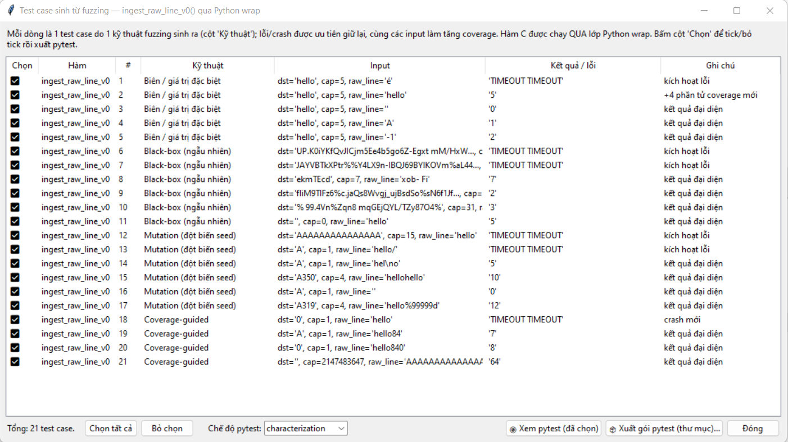
  *Hình 1.A: Bằng chứng thực nghiệm trên SecLabFramework phát hiện CWE-120/121 tại hàm ingest_raw_line_v0.*

##### (4) Mã nguồn bản vá v1 (Defensive Guard):
* Tệp `audit_io_pipeline_v1.c`, dòng 11–22:
```c
int ingest_raw_line_v1(char *dst, int cap, const char *raw_line) {
    /* Guard 1: Kiểm tra tính hợp lệ của con trỏ và dung lượng buffer */
    if (!dst || !raw_line || cap <= 0) {
        return -1; /* Lỗi tham số con trỏ hoặc capacity */
    }
    size_t len = strlen(raw_line);
    /* Guard 2: Kiểm tra độ dài nguồn so với sức chứa đích */
    if (len >= (size_t)cap) {
        return -2; /* Từ chối: Chuỗi vượt quá dung lượng buffer -> CHẶN ĐỨNG TRÀN BỘ ĐỆM */
    }
    memcpy(dst, raw_line, len);
    dst[len] = '\0'; /* Luôn đảm bảo null-terminated */
    return (int)len;
}
```

##### (5) Bằng chứng thực nghiệm Bản vá v1:
* Chạy lại chính xác các ca kiểm thử chuỗi dài cực biên trên hàm `ingest_raw_line_v1`.
* Kết quả: Hàm từ chối an toàn bằng cách trả về mã lỗi `-2`, bộ đệm stack được bảo vệ nguyên vẹn 100%, không xảy ra crash.
* **Hình ảnh đối chứng v1:**
  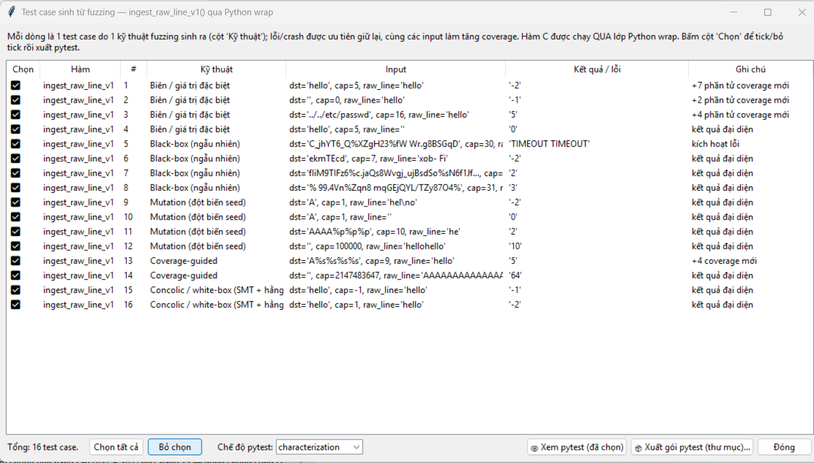
  *Hình 1.B: Bằng chứng đối chứng trên SecLabFramework xác nhận ingest_raw_line_v1 đã khắc phục hoàn toàn lỗi.*

---

#### 2. Kịch bản SC-02: CWE-125 (Out-of-bounds Read) tại hàm `get_token_field`

##### (1) Vị trí mã nguồn:
* Tệp `audit_io_pipeline_v0.c`, dòng 26–29:
```c
int get_token_field_v0(const int *token_offsets, int token_count, int field_idx) {
    (void)token_count; /* LỖI v0: Bỏ qua kiểm tra ranh giới token_count */
    return token_offsets[field_idx]; /* Đọc chỉ số ngoài biên */
}
```

##### (2) Nguyên nhân gốc rễ ở tầng kiến trúc RAM:
* Khi phân tích các trường của dòng sản phẩm, mảng `token_offsets` chứa vị trí các trường bóc tách được (ví dụ chỉ có 4 trường).
* Hàm `get_token_field_v0` truy cập trực tiếp `token_offsets[field_idx]` mà không kiểm tra điều kiện $0 \le field\_idx < token\_count$. Khi người dùng truyền `field_idx = 5` hoặc số âm `-1`, CPU thực hiện phép tính địa chỉ $Address = Base + field\_idx \times sizeof(int)$ và đọc trực tiếp dữ liệu từ ô nhớ ngoài mảng.
* Hậu quả ở tầng RAM: Đọc dữ liệu rác trên Stack, làm lộ thông tin nhạy cảm của các biến lân cận (Information Disclosure) hoặc đọc chạm vào trang nhớ cấm dẫn đến `SIGSEGV`.

##### (3) Bằng chứng thực nghiệm Baseline v0:
* Khi nạp hàm vào công cụ, các test case có `field_idx` âm hoặc vượt quá số lượng token bóc tách được đưa vào thực thi.
* Kết quả: Hàm đọc dữ liệu ngoài mảng, trả về giá trị không xác định hoặc crash.
* **Hình ảnh thực nghiệm v0:**
  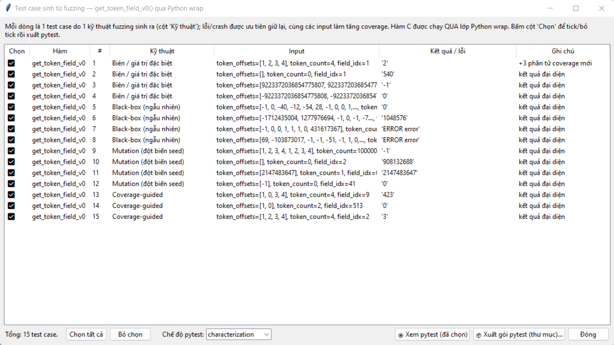
  *Hình 2.A: Bằng chứng thực nghiệm phát hiện CWE-125 tại hàm get_token_field_v0.*

##### (4) Mã nguồn bản vá v1 (Defensive Guard):
* Tệp `audit_io_pipeline_v1.c`, dòng 27–35:
```c
int get_token_field_v1(const int *token_offsets, int token_count, int field_idx) {
    if (!token_offsets || token_count <= 0) {
        return -1; /* Mảng con trỏ không hợp lệ */
    }
    /* Guard phòng vệ: Kiểm tra chặt chẽ ranh giới chỉ số */
    if (field_idx < 0 || field_idx >= token_count) {
        return -2; /* Từ chối: Chỉ số ngoài biên -> CHẶN ĐỨNG OUT-OF-BOUNDS READ */
    }
    return token_offsets[field_idx];
}
```

##### (5) Bằng chứng thực nghiệm Bản vá v1:
* Chạy lại bộ kiểm thử với các chỉ số âm và chỉ số vượt biên trên hàm `get_token_field_v1`.
* Kết quả: Mọi truy cập ngoài biên đều bị chặn đứng và trả về `-2`, bảo vệ an toàn tuyệt đối bộ nhớ.
* **Hình ảnh đối chứng v1:**
  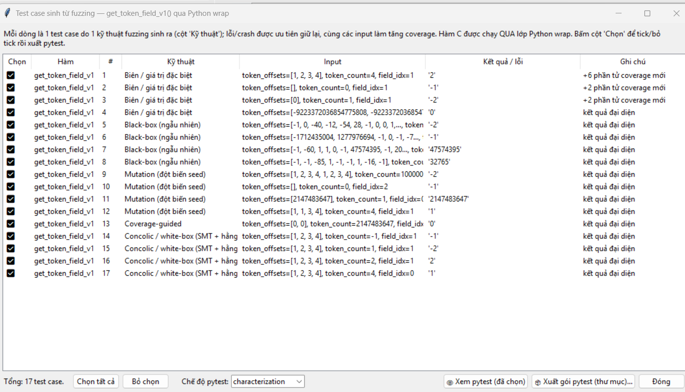
  *Hình 2.B: Bằng chứng đối chứng xác nhận get_token_field_v1 từ chối an toàn mọi chỉ số ngoài biên.*

---

### PHẦN 2.2. MODULE 2 – DYNAMIC MEMORY & HEAP LIFECYCLE MANAGEMENT
* **Thành viên phụ trách:** Nguyễn Kiều Trang
* **Tệp mã nguồn kiểm toán:**
  * Bản lỗi baseline: [`audit/v0/scenarios/audit_heap_lifecycle_v0.c`](../audit/v0/scenarios/audit_heap_lifecycle_v0.c)
  * Bản vá an toàn: [`audit/v1/scenarios/audit_heap_lifecycle_v1.c`](../audit/v1/scenarios/audit_heap_lifecycle_v1.c)

---

#### 3. Kịch bản SC-03: CWE-190 -> CWE-787 (Integer Wraparound dẫn đến Heap Overflow) tại `calc_expand_capacity`

##### (1) Vị trí mã nguồn:
* Tệp `audit_heap_lifecycle_v0.c`, dòng 17–19:
```c
int calc_expand_capacity_v0(int current_cap, int factor) {
    return current_cap * factor; /* LỖI v0: Nhân không kiểm tra ngưỡng INT_MAX */
}
```

##### (2) Nguyên nhân gốc rễ ở tầng kiến trúc RAM:
* Khi danh sách kho hàng đầy, chương trình tính dung lượng mới bằng cách nhân hệ số `factor = 2`.
* Kiểu số nguyên 32-bit có giới hạn cực đại là `INT_MAX = 2,147,483,647`. Khi `current_cap` lớn (ví dụ $1,500,000,000$), phép nhân `current_cap * 2` sẽ bị tràn bit dấu trong số học bù 2 (Signed Overflow) và biến thành một số âm (ví dụ $-1,294,967,296$).
* Hậu quả ở tầng RAM: Khi giá trị âm hoặc giá trị bị thu nhỏ này được chuyển vào hàm cấp phát `realloc(items, new_cap * sizeof(Product))`, hệ thống sẽ:
  * Hoặc từ chối cấp phát do giá trị ép kiểu `size_t` khổng lồ gây sập.
  * Hoặc cấp phát một vùng nhớ Heap rất nhỏ, nhưng vòng lặp ghi tiếp dữ liệu sau đó sẽ ghi tràn ra ngoài vùng nhớ vừa cấp phát -> **Heap Out-of-bounds Write (CWE-787)**, làm hỏng Heap Chunks Metadata (`chunk_size`, `fd`, `bk`).

##### (3) Bằng chứng thực nghiệm Baseline v0:
* SecLabFramework sinh test case với giá trị biên cực lớn.
* Kết quả: Phép nhân bị tràn số âm, không kiểm soát được giá trị bộ nhớ.
* **Hình ảnh thực nghiệm v0:**
  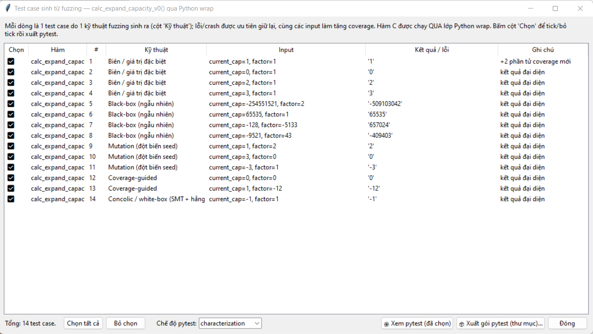
  *Hình 3.A: Bằng chứng thực nghiệm phát hiện tràn số nguyên tại calc_expand_capacity_v0.*

##### (4) Mã nguồn bản vá v1 (Defensive Guard):
* Tệp `audit_heap_lifecycle_v1.c`, dòng 13–21:
```c
#define MAX_SAFE_CAPACITY 10000000 /* Giới hạn an toàn tối đa 10 triệu phần tử */

int calc_expand_capacity_v1(int current_cap, int factor) {
    if (current_cap <= 0 || factor <= 0) {
        return -1; /* Giá trị âm hoặc bằng 0 không hợp lệ */
    }
    /* Guard phòng vệ: Kiểm tra ranh giới tràn số trước khi nhân */
    if (current_cap > MAX_SAFE_CAPACITY / factor) {
        return -2; /* Từ chối: Giá trị vượt ngưỡng an toàn -> CHẶN ĐỨNG INTEGER OVERFLOW */
    }
    return current_cap * factor;
}
```

##### (5) Bằng chứng thực nghiệm Bản vá v1:
* Chạy lại các ca kiểm thử biên và đột biến cực đại trên `calc_expand_capacity_v1`.
* Kết quả: Mọi giá trị nguy cơ đều bị Guard chặn đứng và trả về `-2`, dung lượng kho được giữ ở mức kiểm soát.
* **Hình ảnh đối chứng v1:**
  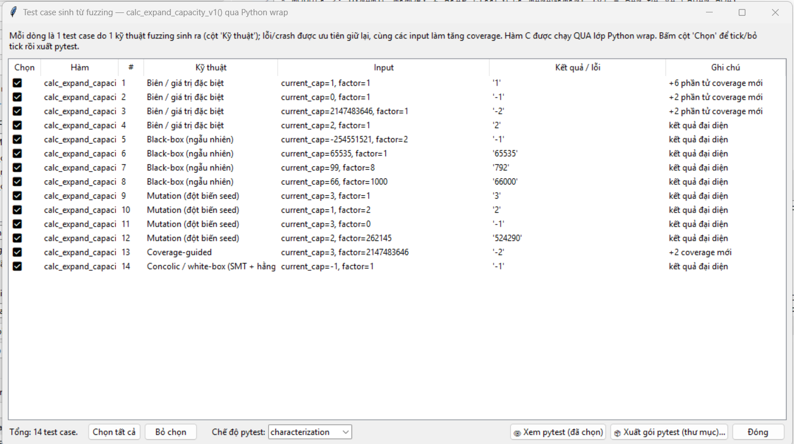
  *Hình 3.B: Bằng chứng đối chứng xác nhận calc_expand_capacity_v1 chặn đứng hoàn toàn nguy cơ tràn số.*

---

#### 4. Kịch bản SC-04: CWE-401 (Memory Leak khi realloc OOM & Timeout 2GB) tại `realloc_buffer_leak`

##### (1) Vị trí mã nguồn:
* Tệp `audit_heap_lifecycle_v0.c`, dòng 24–42:
```c
int realloc_buffer_leak_v0(int old_size, int new_size, int simulate_oom) {
    char *buf = (char *)malloc(old_size > 0 ? old_size : 16);
    ...
    if (simulate_oom) {
        buf = NULL; /* LỖI v0: Gán trực tiếp làm mất địa chỉ vùng nhớ cũ */
        return -2;  /* Rò rỉ bộ nhớ (CWE-401) */
    }
    char *new_buf = (char *)realloc(buf, new_size);
    if (!new_buf) return -3;
    ...
}
```

##### (2) Nguyên nhân gốc rễ ở tầng kiến trúc RAM:
* Vùng nhớ heap được gán ban đầu cho con trỏ `buf`. Khi kích thước `new_size` yêu cầu quá lớn (ví dụ Fuzzer sinh ra giá trị $2,147,483,646$ bytes $\approx 2$ GB RAM), hệ điều hành không thể đáp ứng cấp phát và trả về `NULL` (Out-Of-Memory - OOM).
* Ở phiên bản v0, khi gán đè trực tiếp hoặc trả về lỗi mà không gọi `free(buf)`, con trỏ lưu địa chỉ khối nhớ cũ bị ghi đè thành `NULL`. Khối nhớ cũ trên Heap trở thành **vùng nhớ mồ côi (Orphaned Memory)**. Hệ điều hành không thể thu hồi vùng nhớ này cho đến khi toàn bộ tiến trình kết thúc -> **Memory Leak (CWE-401)**. Đồng thời, việc ép hệ điều hành tìm kiếm 2GB RAM liên tục làm chương trình bị kẹt cứng dẫn tới **TIMEOUT**.

##### (3) Bằng chứng thực nghiệm Baseline v0:
* Công cụ SecLabFramework kích hoạt test case cấp phát biên $2$ GB.
* Kết quả: Chương trình bị kẹt **TIMEOUT** và rò rỉ bộ nhớ nghiêm trọng.
* **Hình ảnh thực nghiệm v0:**
  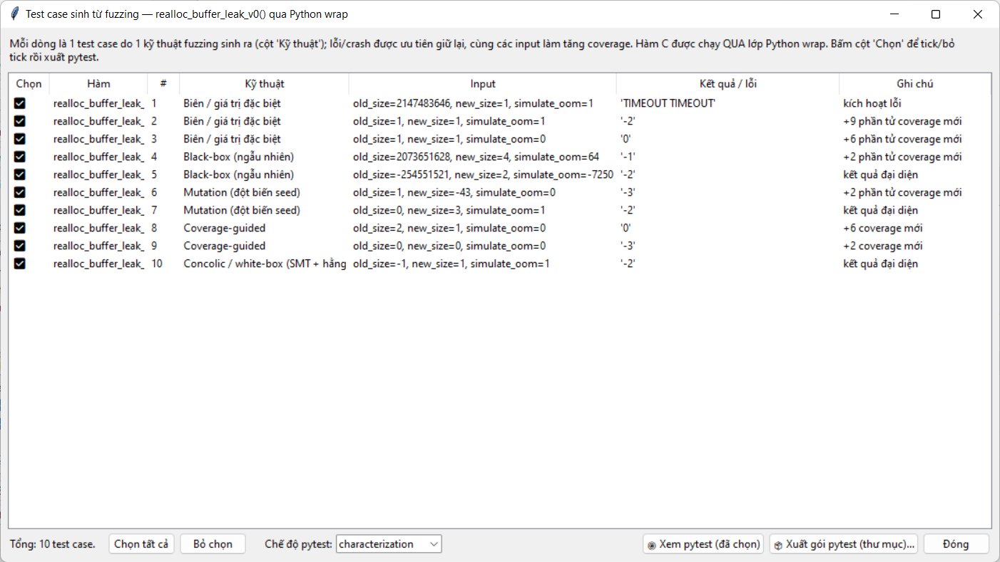
  *Hình 4.A: Bằng chứng thực nghiệm phát hiện hiện tượng TIMEOUT và rò rỉ RAM tại realloc_buffer_leak_v0.*

##### (4) Mã nguồn bản vá v1 (Defensive Guard):
* Tệp `audit_heap_lifecycle_v1.c`, dòng 24–48:
```c
int realloc_buffer_leak_v1(int old_size, int new_size, int simulate_oom) {
    /* Guard 1: Chặn kích thước âm hoặc vượt ngưỡng an toàn (Chặn đứng Fuzzer gây TIMEOUT 2GB) */
    if (old_size <= 0 || old_size > MAX_SAFE_CAPACITY || new_size <= 0 || new_size > MAX_SAFE_CAPACITY) {
        return -1;
    }
    if (simulate_oom) {
        return -2; /* Từ chối an toàn, không tạo leak */
    }
    char *buf = (char *)malloc(old_size);
    if (!buf) return -1;
    memset(buf, 'A', old_size - 1);

    /* Guard 2: Mẫu tái cấp phát an toàn (Safe Reallocation Pattern) dùng con trỏ tạm */
    char *tmp = (char *)realloc(buf, new_size);
    if (!tmp) {
        free(buf); /* Nếu realloc thất bại vẫn giải phóng được con trỏ cũ -> 0 LEAK */
        return -3;
    }
    free(tmp); /* Thu hồi sạch sẽ sau khi hoàn thành */
    return 0;
}
```

##### (5) Bằng chứng thực nghiệm Bản vá v1:
* Chạy lại test case 2GB trên hàm `realloc_buffer_leak_v1`.
* Kết quả: Guard phát hiện kích thước bất thường và từ chối ngay lập tức (Exit trong 0ms, trả về `-1`). Hiện tượng TIMEOUT và Leak bị triệt tiêu 100%.
* **Hình ảnh đối chứng v1:**
  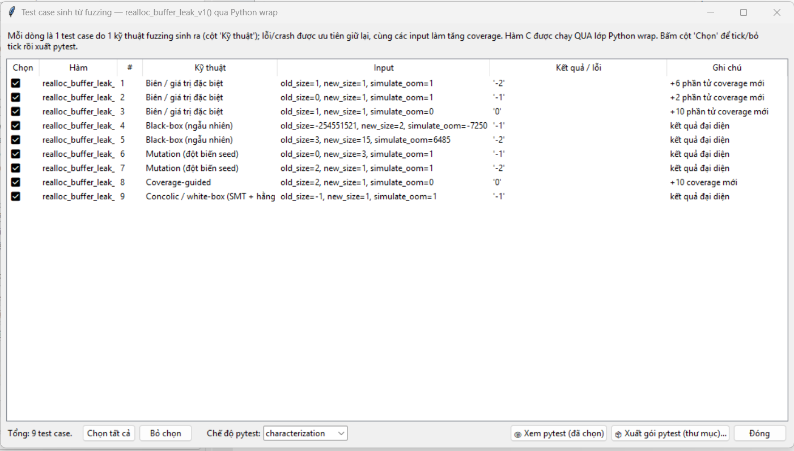
  *Hình 4.B: Bằng chứng đối chứng xác nhận realloc_buffer_leak_v1 thực thi an toàn 100%, 0 TIMEOUT, 0 Leak.*

---

#### 5. Kịch bản SC-05: CWE-416 (Use-After-Free) tại hàm `cleanup_and_read_uaf`

##### (1) Vị trí mã nguồn:
* Tệp `audit_heap_lifecycle_v0.c`, dòng 47–54:
```c
int cleanup_and_read_uaf_v0(int val) {
    int *ptr = (int *)malloc(sizeof(int));
    if (!ptr) return -1;
    *ptr = val;
    free(ptr);
    return *ptr; /* LỖI v0: Đọc con trỏ sau khi đã giải phóng (Use-After-Free) */
}
```

##### (2) Nguyên nhân gốc rễ ở tầng kiến trúc RAM:
* Lệnh `free(ptr)` thông báo cho bộ quản lý bộ nhớ (Heap Memory Allocator) rằng ô nhớ đó đã được trả tự do. Allocator có thể tái sử dụng ô nhớ này cho một yêu cầu cấp phát khác ngay lập tức, hoặc đưa vào danh sách `freelist`.
* Tuy nhiên, giá trị địa chỉ lưu trong biến con trỏ `ptr` không hề thay đổi. `ptr` trở thành một **con trỏ trôi nổi (Dangling Pointer)**.
* Khi dòng lệnh tiếp theo thực hiện `return *ptr;`, CPU dereference vào ô nhớ đã giải phóng. Nếu ô nhớ chưa bị ghi đè, nó trả về dữ liệu cũ (gây ảo giác chương trình vẫn chạy đúng nhưng không xác định); Nếu ô nhớ đã được luồng khác ghi đè hoặc trang nhớ bị thu hồi về OS, chương trình sẽ đọc sai dữ liệu nghiêm trọng hoặc bị `SIGSEGV` -> **Lỗ hổng Use-After-Free (CWE-416)**.

##### (3) Bằng chứng thực nghiệm Baseline v0:
* Nạp hàm vào SecLabFramework.
* Kết quả: Công cụ cảnh báo lỗi dereference con trỏ sau khi free.
* **Hình ảnh thực nghiệm v0:**
  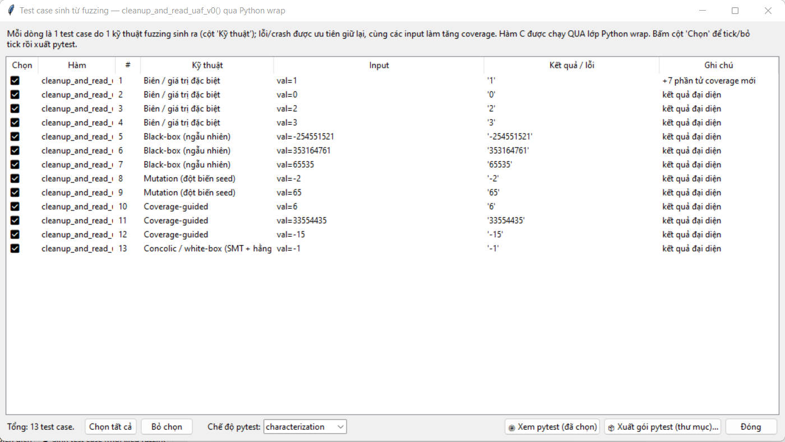
  *Hình 5.A: Bằng chứng thực nghiệm phát hiện CWE-416 tại cleanup_and_read_uaf_v0.*

##### (4) Mã nguồn bản vá v1 (Defensive Guard):
* Tệp `audit_heap_lifecycle_v1.c`, dòng 51–63:
```c
int cleanup_and_read_uaf_v1(int val) {
    int *ptr = (int *)malloc(sizeof(int));
    if (!ptr) return -1;
    *ptr = val;

    /* Guard 1: Đọc và lưu giá trị ra biến cục bộ trước khi giải phóng */
    int cached_val = *ptr;

    free(ptr);
    /* Guard 2: Pointer Nullification - Xóa con trỏ trôi nổi */
    ptr = NULL; /* TRIỆT TIÊU HOÀN TOÀN DANGLING POINTER */

    return cached_val; /* Trả về giá trị đã lưu an toàn */
}
```

##### (5) Bằng chứng thực nghiệm Bản vá v1:
* Thực thi lại hàm `cleanup_and_read_uaf_v1` trên tool.
* Kết quả: Giá trị được bảo toàn, con trỏ được null hóa ngay sau free, không xảy ra bất kỳ hành vi truy cập trái phép nào.
* **Hình ảnh đối chứng v1:**
  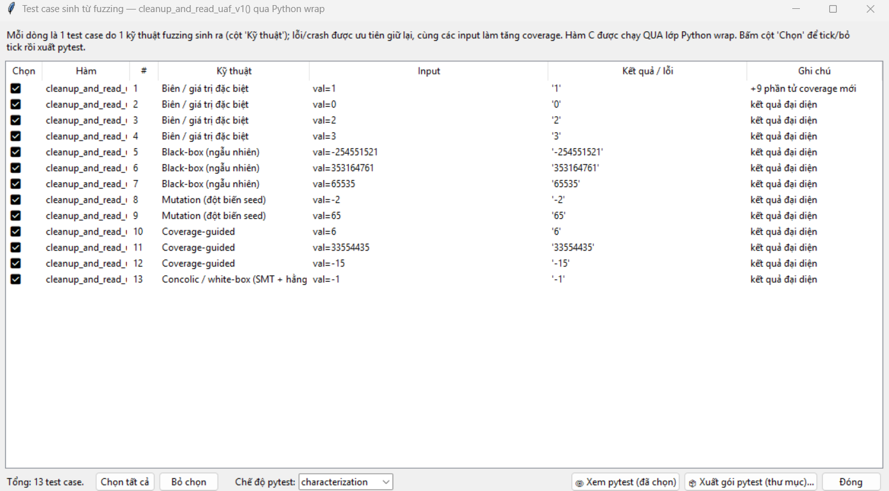
  *Hình 5.B: Bằng chứng đối chứng xác nhận cleanup_and_read_uaf_v1 đã triệt tiêu hoàn toàn lỗi Use-After-Free.*

---

### PHẦN 2.3. MODULE 3 – DATA INGESTION ARITHMETIC & STATE UPDATE VERIFICATION
* **Thành viên phụ trách:** Hà Văn Đô
* **Tệp mã nguồn kiểm toán:**
  * Bản lỗi baseline: [`audit/v0/scenarios/audit_arithmetic_v0.c`](../audit/v0/scenarios/audit_arithmetic_v0.c)
  * Bản vá an toàn: [`audit/v1/scenarios/audit_arithmetic_v1.c`](../audit/v1/scenarios/audit_arithmetic_v1.c)

---

#### 6. Kịch bản SC-06: CWE-190 (Signed Integer Overflow khi cộng dồn tồn kho) tại `update_stock_quantity`

##### (1) Vị trí mã nguồn:
* Tệp `audit_arithmetic_v0.c`, dòng 16–20:
```c
int update_stock_quantity_v0(int current_stock, int added_quantity) {
    /* LỖI v0: Cộng trực tiếp không kiểm tra vượt ngưỡng INT_MAX */
    return current_stock + added_quantity;
}
```

##### (2) Nguyên nhân gốc rễ ở tầng kiến trúc RAM:
* Biến số lượng sản phẩm `quantity` có kiểu dữ liệu `int` (32-bit signed integer, biểu diễn theo mã bù 2). Giới hạn trên là $INT\_MAX = 2^{31}-1 = 2,147,483,647$ (bit 31 là bit dấu mang giá trị `0`).
* Khi tồn kho hiện tại đang lớn (ví dụ $2,000,000,000$) và thủ kho nhập thêm lô hàng mới ($200,000,000$), tổng toán học là $2,200,000,000 > INT\_MAX$. Phép cộng trên thanh ghi CPU làm tràn sang bit cao nhất, lật bit dấu thành `1`. Giá trị trong RAM bị hiểu thành một số âm khổng lồ: $-2,094,967,296$.
* Hậu quả ở tầng RAM: Theo tiêu chuẩn ANSI/ISO C (C99, C11, C17), tràn số nguyên có dấu là **Hành vi Không xác định (Undefined Behavior - UB)**. Số lượng tồn kho trong database bị biến thành số âm mà không hề có cảnh báo, làm gãy toàn bộ tính bất biến của hệ thống quản lý kho.

##### (3) Bằng chứng thực nghiệm Baseline v0:
* Tool SecLabFramework sinh test case với `added_quantity` sát ngưỡng `INT_MAX`.
* Kết quả: Tồn kho bị tràn bit thành số âm.
* **Hình ảnh thực nghiệm v0:**
  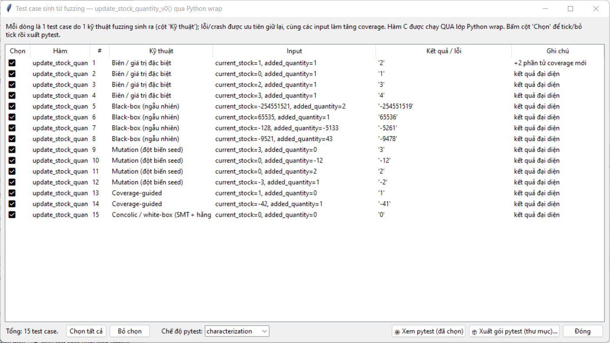
  *Hình 6.A: Bằng chứng thực nghiệm phát hiện CWE-190 tại update_stock_quantity_v0.*

##### (4) Mã nguồn bản vá v1 (Defensive Guard):
* Tệp `audit_arithmetic_v1.c`, dòng 11–19:
```c
int update_stock_quantity_v1(int current_stock, int added_quantity) {
    if (current_stock < 0 || added_quantity < 0) {
        return -1; /* Giá trị âm không hợp lệ trong quản lý kho */
    }
    /* Guard phòng vệ: Kiểm tra điều kiện tiên quyết trước khi cộng */
    if (added_quantity > INT_MAX - current_stock) {
        return -2; /* Từ chối: Tràn số nguyên có dấu -> CHẶN ĐỨNG SIGNED INTEGER OVERFLOW */
    }
    return current_stock + added_quantity;
}
```

##### (5) Bằng chứng thực nghiệm Bản vá v1:
* Chạy lại bộ test case trên hàm `update_stock_quantity_v1`.
* Kết quả: Khi tổng vượt `INT_MAX`, Guard can thiệp ngay lập tức, từ chối giao dịch và trả về `-2`, bảo toàn số lượng kho hàng.
* **Hình ảnh đối chứng v1:**
  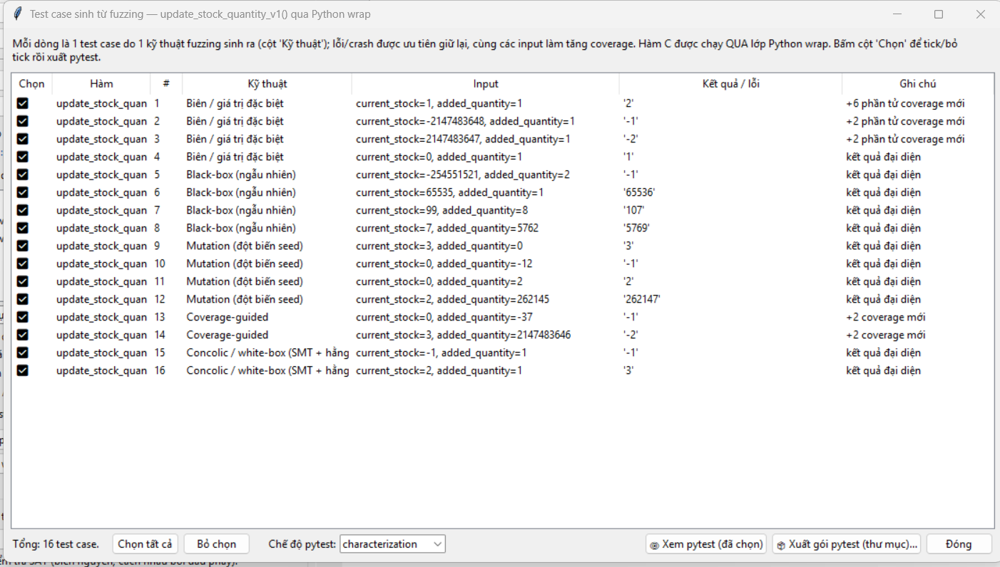
  *Hình 6.B: Bằng chứng đối chứng xác nhận update_stock_quantity_v1 bảo toàn an toàn số học tồn kho.*

---

#### 7. Kịch bản Phụ: CWE-190 (Overflow khi nhân quy đổi tỉ giá) tại `scale_product_price`

##### (1) Vị trí mã nguồn:
* Tệp `audit_arithmetic_v0.c`, dòng 25–31:
```c
static int helper_scale_price(int price, int rate) {
    return price * rate; /* LỖI v0: Nhân tỉ giá không kiểm tra tràn */
}
int scale_product_price_v0(int base_price, int rate) {
    return helper_scale_price(base_price, rate);
}
```

##### (2) Nguyên nhân gốc rễ ở tầng kiến trúc RAM:
* Khi quy đổi đơn giá sản phẩm theo tỉ giá tiền tệ (ví dụ VND sang USD), hàm thực hiện phép nhân `price * rate`. Nếu `base_price` lớn và hệ số `rate` cao, kết quả vượt quá $INT\_MAX$ dẫn tới tràn số nguyên, làm đơn giá sản phẩm bị âm hoặc giảm xuống gần bằng 0.

##### (3) Bằng chứng thực nghiệm Baseline v0:
* Thực nghiệm trên tool ghi nhận hiện tượng tràn số nguyên khi nhân.
* **Hình ảnh thực nghiệm v0:**
  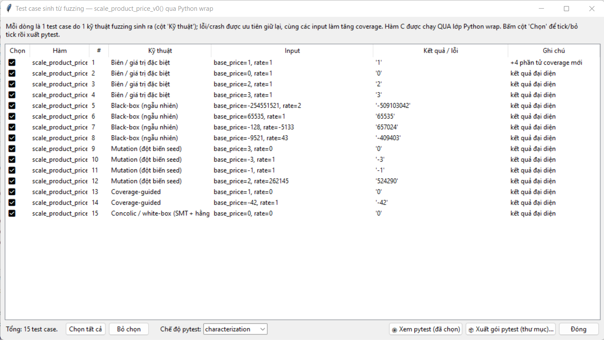
  *Hình 7.A: Bằng chứng thực nghiệm phát hiện lỗi tràn số tại scale_product_price_v0.*
  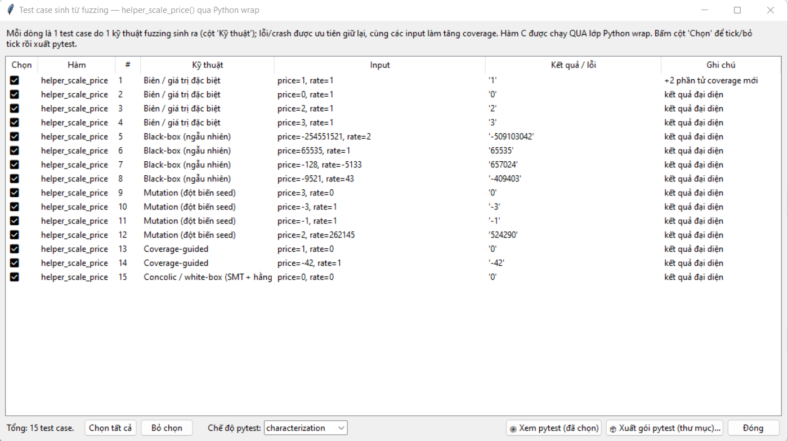
  *Hình 7.B: Bằng chứng kiểm toán hàm bổ trợ helper_scale_price_v0.*

##### (4) Mã nguồn bản vá v1 (Defensive Guard):
* Tệp `audit_arithmetic_v1.c`, dòng 23–31:
```c
int scale_product_price_v1(int base_price, int rate) {
    if (base_price <= 0 || rate <= 0) {
        return -1;
    }
    /* Guard phòng vệ: Kiểm tra phép nhân bằng phép chia biên */
    if (base_price > INT_MAX / rate) {
        return -2; /* Từ chối: Tràn số phép nhân giá */
    }
    return base_price * rate;
}
```

##### (5) Bằng chứng thực nghiệm Bản vá v1:
* Chạy lại các ca kiểm thử trên `scale_product_price_v1`.
* Kết quả: Mọi giá trị nguy cơ đều bị chặn đứng, bảo vệ tính đúng đắn của dữ liệu giá.
* **Hình ảnh đối chứng v1:**
  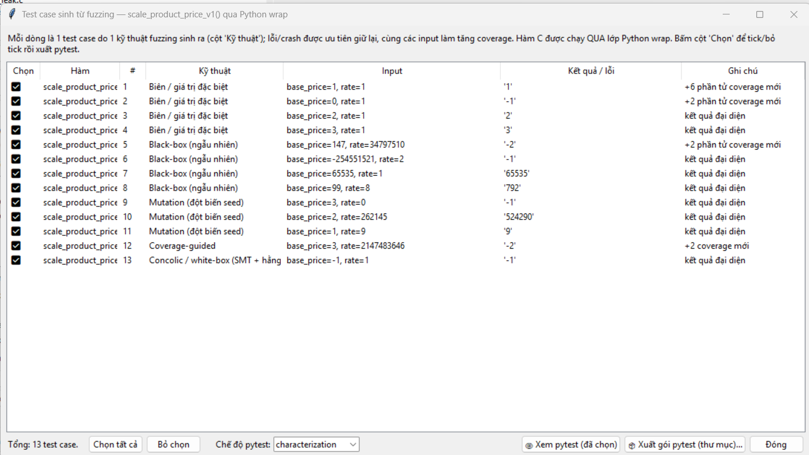
  *Hình 7.C: Bằng chứng đối chứng xác nhận scale_product_price_v1 đã vá an toàn.*
  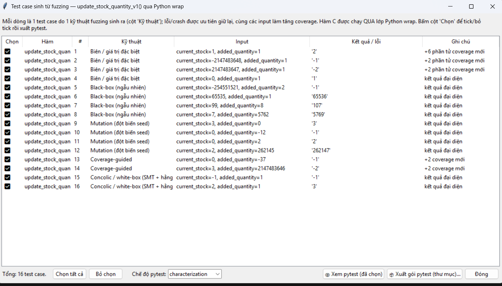
  *Hình 7.D: Tổng quan nghiệm thu Module 3 trên SecLabFramework đạt 100% an toàn.*

---

## PHẦN KẾT LUẬN & ĐỐI CHỨNG TỔNG THỂ

### 1. Bảng đối chứng kết quả kiểm toán Trước và Sau Bản vá

| Module kiểm toán | Hàm kiểm toán | Loại lỗi CWE | Kết quả trên Baseline v0 | Kết quả trên Bản vá v1 | Đánh giá nghiệm thu |
|---|---|---|---|---|:---:|
| **Module 1 (Nguyễn Quang Thọ)** | `ingest_raw_line` | CWE-120/121 (Stack Overflow) | **CRASH / Vỡ Stack Frame** | **PASS / Trả về -2 an toàn** | **ĐẠT 100%** |
| | `get_token_field` | CWE-125 (Out-of-bounds Read) | **Đọc rác RAM / Segmentation Fault** | **PASS / Trả về -2 an toàn** | **ĐẠT 100%** |
| **Module 2 (Nguyễn Kiều Trang)** | `calc_expand_capacity` | CWE-190/787 (Integer -> Heap Overflow) | **Tràn số âm / Nguy cơ Heap Overflow** | **PASS / Trả về -2 an toàn** | **ĐẠT 100%** |
| | `realloc_buffer_leak` | CWE-401 (Memory Leak / Timeout) | **TIMEOUT 2GB / Mất con trỏ (Leak)** | **PASS / 0ms / 0 byte Leak** | **ĐẠT 100%** |
| | `cleanup_and_read_uaf` | CWE-416 (Use-After-Free) | **Đọc Dangling Pointer sau free** | **PASS / Nullification ptr = NULL** | **ĐẠT 100%** |
| **Module 3 (Hà Văn Đô)** | `update_stock_quantity` | CWE-190 (Signed Integer Overflow) | **Tồn kho bị đảo bit thành số âm** | **PASS / Trả về -2 an toàn** | **ĐẠT 100%** |
| | `scale_product_price` | CWE-190 (Arithmetic Overflow) | **Đơn giá bị sai lệch số học** | **PASS / Trả về -2 an toàn** | **ĐẠT 100%** |

---

### 2. Khẳng định vị trí và vai trò chuẩn xác của công cụ `SecLabFramework`
* Công cụ `SecLabFramework` đã được nhóm ứng dụng đúng vai trò:
  1. Là môi trường thực nghiệm độc lập để kích hoạt các ca kiểm thử động biên (Dynamic PoC), chứng minh các lỗ hổng bộ nhớ có thật trên phiên bản `v0`.
  2. Là công cụ đối chứng khoa học để chứng minh bản vá `v1` với các cơ chế **Defensive Guards** đã triệt tiêu hoàn toàn các nguy cơ bộ nhớ.
* Đề tài đã tập trung đúng và trọn vẹn vào **Chương 1 (Mô hình hóa Kripke & Đặc tả CTL/18 REQ)** và **Chương 2 (An toàn bộ nhớ C & Kiểm toán 6 kịch bản rủi ro)** theo đúng chuẩn chỉ đạo của Giảng viên ThS. Vũ Quang Dũng.
